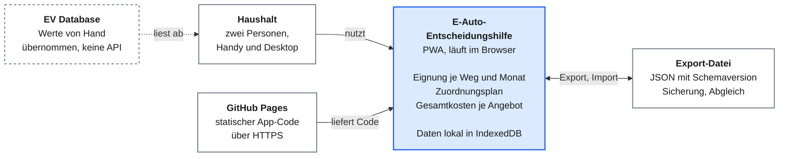
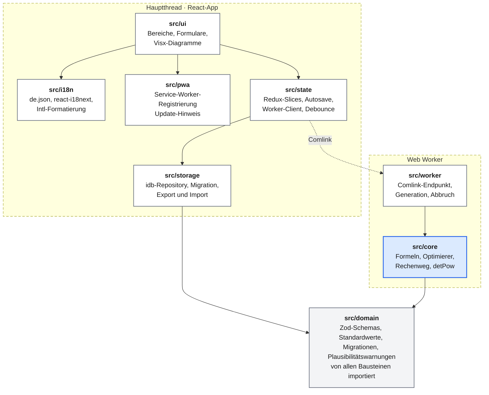
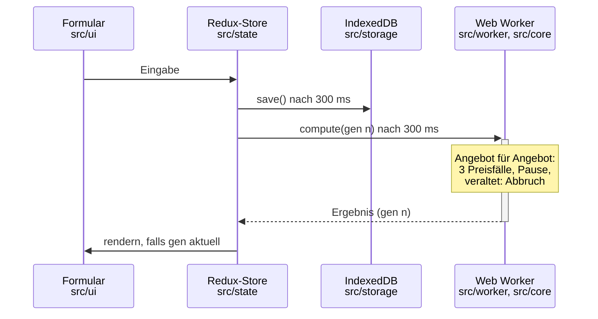
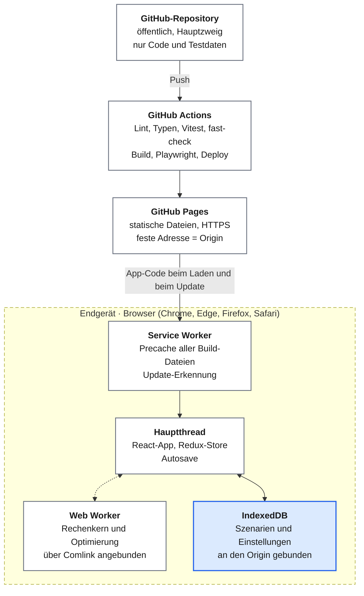

# Wattwahl – Architekturdokumentation (arc42)

Nov 13, 2026 · @Eduard Vodicka

## 1. Einführung und Ziele

Wattwahl wird als rein clientseitige React-PWA gebaut: Rechenkern im Web Worker, Daten in IndexedDB, Auslieferung über GitHub Pages. Fachliche Regeln, Formeln und Testfälle stehen ausschließlich in der Spezifikation: Wattwahl – E-Auto-Entscheidungshilfe. Dieses Dokument legt fest, wie sie technisch umgesetzt werden.

### 1.1 Aufgabenstellung

Für jedes Angebot (Kauf oder Leasingstufe) eines E-Auto-Kandidaten berechnet die App:

1. die Eignung für alle Arbeitswege in jedem Monat,
2. den kostenoptimalen Zuordnungsplan von E-Auto und Verbrenner je Tagestyp und Anwesenheitszustand,
3. die Gesamtkosten der Flotte über die Vergleichsdauer, mit Spanne über drei Preisfälle.

### 1.2 Qualitätsziele

| Prio | Qualitätsziel | Bedeutung für die Architektur |
| --- | --- | --- |
| 1 | Korrektheit und Nachvollziehbarkeit | Formeln in genau einem Modul, jede Ergebniszahl mit Rechenweg, alle 18 Testfälle automatisiert |
| 2 | Performance | 10 Kandidaten × 5 Angebote × 3 Preisfälle in ≤ 5 s am Handy und ≤ 2 s am Desktop, Oberfläche bleibt bedienbar |
| 3 | Datenhoheit und Robustheit | Daten verlassen das Gerät nur per Export. Fehlerhafte Eingaben oder Importe führen nie zu Absturz oder Datenverlust |
| 4 | Offline-Fähigkeit | Nach der Installation ohne Netz voll nutzbar, der Stand übersteht einen Neustart |
| 5 | Wartbarkeit | Rechenkern ohne UI-Abhängigkeiten, Grenzen per Lint-Regel erzwungen |

### 1.3 Stakeholder

| Rolle | Erwartung |
| --- | --- |
| Haushalt (zwei Personen, Nutzer) | Belastbarer Kostenvergleich auf Handy und Desktop, Daten bleiben privat |
| Entwicklung (auch KI-gestützt) | Eindeutige Bausteine, Schnittstellen und Testbasis als Vorgabe für die Implementierung |
| Betrieb (Eigentümer des Repositorys) | Kostenloses Hosting ohne Serverpflege |

## 2. Randbedingungen

Die Plattform ist durch die Spezifikation fest vorgegeben: statische Seite, kein Server, kein Netzwerkverkehr außer dem Laden der App.

### 2.1 Technisch

| Randbedingung | Folge für die Architektur |
| --- | --- |
| Hosting auf GitHub Pages im kostenlosen Plan, öffentliches Repository | Keine eigenen HTTP-Header (kein COOP/COEP, keine CSP per Header), kein SPA-Fallback, keine Nutzerdaten im Repository |
| Kein Server, keine Benutzerkonten, keine Live-Preise | Gesamte Logik im Browser, Geräteabgleich nur über Export-Datei |
| Keine Cookies, keine Analyse, keine Laufzeit-Abhängigkeit von externen Diensten | Alle Bibliotheken werden mitgebaut, keine CDN-Einbindung |
| Aktuelle Chrome, Edge, Firefox und Safari auf Desktop und Handy | Nur Web-Standards mit Unterstützung in allen drei Engines (Blink, Gecko, WebKit) (Web Worker, IndexedDB, Service Worker) |
| Stabile Adresse, weil der Browser-Speicher an den Origin gebunden ist | Der Origin ist `https://wattwahl.evodicka.dev` und wird nicht geändert, Vite-`base` ist fest `/` |
| Sprache Deutsch, Euro, Kilometer, Dezimalkomma | Formatierung über `Intl` mit Locale `de-DE`, Texte in einer Sprachdatei |

### 2.2 Organisatorisch

- Die Spezifikation ist fachlich verbindlich. Abweichungen werden dort geändert, nicht im Code entschieden.
- Build, Tests und Veröffentlichung laufen über GitHub Actions bei jedem Push auf den Hauptzweig.
- Alle Abhängigkeiten haben eine freie Lizenz und sind in `package.json` exakt gepinnt.

### 2.3 Konventionen

- TypeScript im Strict-Modus, ESLint und Prettier im CI verpflichtend.
- Code-Bezeichner auf Englisch, Fachbegriffe nach der Zuordnung im Glossar (Kapitel 12). Oberflächentexte nur auf Deutsch und nur über die Sprachdatei.
- Architekturdiagramme nach dem C4-Modell, Entscheidungen als ADR in Kapitel 9.

## 3. Kontextabgrenzung

Die App hat genau zwei technische Schnittstellen nach außen: das Laden des Codes von GitHub Pages und die Export-Datei.

**Systemkontext · 4 Nachbarn, 1 System**

*Nur App-Code kommt aus dem Netz, alle Daten bleiben auf dem Gerät. C4 Ebene 1 · Systemkontext.*

Die EV Database ist nur eine Quelle für den Nutzer (gestrichelt). Die App ruft sie nicht auf und importiert nichts von dort.

| Nachbar | Richtung | Inhalt | Technik |
| --- | --- | --- | --- |
| Haushalt | beidseitig | Eingaben, Ergebnisansichten | Browser-Oberfläche, Touch und Tastatur |
| GitHub Pages | zur App | HTML, JavaScript, CSS, Manifest, Icons | HTTPS GET, nur beim Laden und beim Update |
| Export-Datei | beidseitig | Szenarien mit Schemaversion | Download per Blob-URL, Auswahl per `<input type="file">` |
| EV Database | zum Haushalt | Reichweiten, Netto-Kapazität | keine, manuelle Übernahme |

## 4. Lösungsstrategie

Ein reiner, deterministischer Rechenkern läuft getrennt von der Oberfläche im Web Worker. Zod-Schemas sind die einzige Quelle für Datentypen, Speicherformat und Import.

### 4.1 Ziele und Ansätze

| Qualitätsziel | Ansatz | Details |
| --- | --- | --- |
| Korrektheit, Nachvollziehbarkeit | Formeln als reine Funktionen in `src/core/calc`, jede Funktion liefert Wert und Rechenweg-Eintrag | 8.4, 8.13 |
| Performance | Rechenkern im Web Worker, dynamische Programmierung nach Spezifikation, Optionsmengen werden geteilt | 6.1, 8.5 |
| Bedienbarkeit während der Rechnung | Debounce 300 ms, Generation-Token, kooperativer Abbruch zwischen Angeboten | 8.5 |
| Datenhoheit, Robustheit | IndexedDB lokal, Import nur über `JSON.parse` und Zod, Schreiben in einer Transaktion | 8.2, 8.3 |
| Offline | Precache aller Assets über vite-plugin-pwa, kein Netzwerkzugriff zur Laufzeit | 8.12 |
| Wartbarkeit | Ein Paket mit Schichten, Importgrenzen per ESLint, Fachbegriffe mit fester Code-Zuordnung | 5, 12 |

### 4.2 Technologie-Stack

| Bereich | Wahl |
| --- | --- |
| Sprache und Build | TypeScript (strict), Vite |
| UI | React mit React Router im Hash-Modus (`createHashRouter`) |
| UI-Zustand | Redux Toolkit mit React-Redux |
| Styling | CSS Modules, Design-Tokens als CSS Custom Properties |
| Diagramme | Visx (SVG) |
| Texte und Formate | react-i18next, `Intl.NumberFormat` mit `de-DE` |
| Worker-Anbindung | Comlink |
| Speicher | IndexedDB über idb |
| Schema und Validierung | Zod |
| Offline und Updates | vite-plugin-pwa (Workbox) |
| Tests | Vitest, React Testing Library, fast-check, Playwright, @axe-core/playwright |
| Qualität | ESLint mit Importgrenzen, Prettier |
| Auslieferung | GitHub Actions, GitHub Pages |

## 5. Bausteinsicht

Die App ist ein Paket mit acht Modulen unter `src/`. Abhängigkeiten laufen nur in Pfeilrichtung und werden per ESLint geprüft.

**Bausteine · 2 Container, 8 Module**

*Der Rechenkern hängt nur vom Domänenmodell ab. C4 Ebene 2 und 3 · Pfeil = darf importieren, gestrichelt = Thread-Grenze über Comlink.*

Die Oberfläche erreicht den Rechenkern nur über `src/state` und den Worker. `src/core` kennt weder React noch Browser-APIs und ist damit ohne DOM testbar.

### 5.1 Schnittstellen der Module

| Modul | Wichtige Dateien | Öffentliche Schnittstelle |
| --- | --- | --- |
| `src/domain` | `schema.ts`, `defaults.ts`, `offerId.ts`, `settings.ts`, `migrations.ts`, `validation.ts` | `ScenarioSchema`, `ScenarioComputeSchema`, `CandidateComputeSchema`, `DeviceSettingsSchema`, `CURRENT_SCHEMA_VERSION`, `migrate(data)`, `checkWarnings(scenario)` |
| `src/core` | `compute.ts`, `calc/`, `optimizer/`, `math/`, `trace.ts` | `computeOffer(scenario, offer, priceCase, trace?)` |
| `src/worker` | `core.worker.ts` | ` compute({  ``generation, scenario, sliderPrices?` `})`, `explain({ scenario, offerId, priceCase })` über Comlink |
| `src/storage` | `repository.ts`, `exportImport.ts` | `loadAll()`, `save(scenario)`, `exportFile(ids)`, `parseImport(file)`, `writeImport(scenarios, mode)` |
| `src/state` | `store.ts`, `scenarioSlice.ts`, `resultSlice.ts`, `uiSlice.ts`, `listeners.ts`, `coreClient.ts` | `useAppSelector`, `useAppDispatch`, Thunk `requestCompute()` mit Debounce |
| `src/ui` | `areas/`, `components/`, `charts/`, `theme.css` | Routen aus 8.8 |
| `src/i18n` | `de.json`, `index.ts`, `format.ts` | `t()`, `formatEuro()`, `formatKm()`, `formatConsumption()` |
| `src/pwa` | `register.ts` | `useUpdatePrompt()` |

### 5.2 Rechenkern im Detail

Die Dateien in `src/core/calc` bilden die Abschnitte 1 bis 8 der Berechnungslogik der Spezifikation eins zu eins ab: `range.ts`, `soh.ts`, `suitability.ts`, `energy.ts`, `workdays.ts`, `extraMileage.ts`, `prices.ts`, `costs.ts`.

`src/core/optimizer` setzt den Algorithmus der Spezifikation in Schritten um: `thresholds.ts` (Schwellen-SoH je Option), `optionSets.ts` (Rasterwerte mit gleicher Optionsmenge), `knapsack.ts` (dynamische Programmierung), `warranty.ts` (Garantie-Budget), `select.ts` (Zielkosten und Gleichstandsregel). `bruteForce.ts` liegt unter `src/core/optimizer/__tests__` und wird nicht ausgeliefert.

## 6. Laufzeitsicht

Vier Abläufe prägen die Architektur: Neuberechnung nach einer Eingabe, App-Start, Import und App-Update.

### 6.1 Eingabe bis Ergebnis

**Eingabe bis Ergebnis · 4 Beteiligte, 5 Nachrichten**

*Nur das Ergebnis der neuesten Eingabe erreicht die Ansicht. Laufzeitszenario 6.1 · von der Eingabe bis zum Ergebnis.*

Speichern und Rechnen starten unabhängig voneinander nach 300 ms Ruhe. Kommt während der Rechnung eine neue Eingabe, endet der alte Lauf beim nächsten Angebot mit `superseded` (8.5).

### 6.2 App-Start

1. Der Service Worker liefert die App aus dem Cache, auch ohne Netz.
2. Beim ersten Start wird `navigator.``storage.persist()` angefragt. Läuft die App dabei auf iOS nicht als installierte App, erscheint einmalig der Installationshinweis.
3. Das Repository lädt alle Szenarien, migriert ältere Versionen und prüft sie mit Zod.
4. Das aktive Szenario kommt aus `settings`. Gibt es keins, legt src/state ein leeres Szenario aus der Vorlage an.
5. Die erste Berechnung startet, die Export-Erinnerung wird geprüft.

### 6.3 Import

1. Der Nutzer wählt Datei und Modus (ersetzen oder hinzufügen).
2. Größe prüfen, `JSON.parse`, Format-Kennung `eauto-export` prüfen.
3. Jedes Szenario migrieren und mit `safeParse` prüfen. Beim ersten Fehler erscheint die Meldung mit Pfad, es wird nichts geschrieben.
4. Beim Hinzufügen vergibt src/state neue IDs, dann werden alle Szenarien in einer Transaktion geschrieben.
5. Die Stores laden neu, die Berechnung für das aktive Szenario startet.

### 6.4 App-Update

1. Der Service Worker findet eine neue Version und lädt sie im Hintergrund.
2. `useUpdatePrompt()` zeigt den Hinweis.
3. Bei „Aktualisieren“ wird sofort gespeichert, dann aktiviert der neue Service Worker und die Seite lädt neu.
4. Beim folgenden Start migriert das Repository gespeicherte Szenarien (6.2, Schritt 3).

## 7. Verteilungssicht

Es gibt genau eine Umgebung: GitHub Pages für die Dateien, das Endgerät des Nutzers für Rechnung und Speicherung.

**Verteilung · 3 GitHub-Dienste, 4 Laufzeit-Knoten im Browser**

*Der Server liefert nur Dateien, gerechnet und gespeichert wird im Browser. Verteilung · Build bei GitHub, Laufzeit auf dem Endgerät.*

Nach dem ersten Laden kommt die App aus dem Service-Worker-Cache. Die Daten in IndexedDB hängen an der Pages-Adresse, darum bleibt diese fest.

### 7.1 Pipeline

1. `npm ci`
2. Lint (ESLint mit Importgrenzen) und Typprüfung (`tsc --noEmit`)
3. Unit- und Property-Tests (Vitest mit fast-check)
4. Build mit Vite, vite-plugin-pwa erzeugt Manifest und Service Worker
5. End-to-End-Tests mit Playwright gegen `vite preview` in Chromium, Firefox und WebKit
6. Veröffentlichung mit `actions/upload-pages-artifact` und `actions/deploy-pages`, nur vom Hauptzweig

### 7.2 Konfiguration

- Vite `base` ist fest auf `/` gesetzt, der Service Worker nutzt den Scope `/`.
- Quelle von GitHub Pages ist „GitHub Actions“, nicht ein Branch. Die Custom Domain `wattwahl.evodicka.dev` ist in den Repository-Einstellungen gesetzt und HTTPS erzwungen. Eine `CNAME`-Datei im Repository ist bei dieser Quelle wirkungslos und wird nicht angelegt.
- Lokale Entwicklung mit `vite`, Vorschau des PWA-Builds mit `vite preview`.

## 8. Querschnittliche Konzepte

Die Konzepte gelten für alle Bausteine und sind die verbindliche Vorgabe für die Implementierung.

### 8.1 Domänenmodell und Typen

- Die Entitäten aus dem Abschnitt Datenmodell der Spezifikation sind Zod-Schemas in `src/domain/schema.ts`. TypeScript-Typen entstehen nur über `z.infer`, es gibt keine parallel gepflegten Interfaces.
- Das Szenario ist das Aggregat: Es wird als Ganzes geladen, gespeichert, exportiert und an den Worker übergeben.
- IDs sind UUIDs aus `crypto.randomUUID()` und werden nur in `src/state` erzeugt, nie im Rechenkern. Auch beim Import vergibt src/state die neuen IDs, bevor src/storage schreibt.
- Angebote haben keine eigene UUID. Die `offerId` wird abgeleitet: `<candidateId>:purchase` für den Kauf, `<candidateId>:lease:<leaseTierId>` für eine Leasingstufe. Die `leaseTierId` ist die UUID der Leasingstufe (von src/state vergeben), nicht ihre Kilometerstufe, damit die `offerId` stabil bleibt, wenn der Nutzer die Stufe ändert.
- Prozentwerte werden wie eingegeben gespeichert (15 bedeutet 15 %), nur der Rechenkern rechnet sie in Anteile um. Zeitpunkte sind ISO-Strings und die Erstzulassung ist `{ month, year }` mit ganzen Zahlen, denn der Kern kennt kein `Date` und Szenarien reisen als JSON.
- Werte, die in der Parameterliste und in einer Entität der Spezifikation vorkommen, stehen an der Entität: Benzinpreise, Preissteigerung Benzin und Wartung des Verbrenners am Bestandsfahrzeug, freie Tage an der Arbeitsstätte. Wertverlust und Wartung des E-Autos sind Parameter, die der Kandidat überschreiben kann.
- Standardwerte der Parameterliste stehen in `src/domain/defaults.ts`. Jeder Wert trägt das Kennzeichen `placeholder`, `required` oder `fixed`, damit die Oberfläche Annahmen markieren kann.

### 8.2 Persistenz und Migration

- IndexedDB-Datenbank `eauto` mit zwei Stores: `scenarios` (Schlüssel `id`, Wert `{ id, schemaVersion, updatedAt, data }`) und `settings` (ein Eintrag mit aktivem Szenario, Datum des letzten Exports, Intervall der Export-Erinnerung, Farben, Kennzeichen für den ersten Start). settings bleibt auf dem Gerät und ist nicht Teil des Exports.
- Zugriff nur über `src/storage/repository.ts` auf Basis von idb. Kein anderer Baustein öffnet die Datenbank.
- Autosave: Eine Listener-Middleware von Redux Toolkit in src/state/listeners.ts ruft nach 300 ms Ruhe save() des Repositorys auf. Bei `visibilitychange` auf `hidden` und bei `pagehide` wird sofort geschrieben.
- Beim ersten Start wird `navigator.storage.persist()` angefragt. Eine Ablehnung erzeugt einen Hinweis, keinen Fehler.
- Migration: `src/domain/migrations.ts` enthält je Version eine reine Funktion `vN → vN+1`. Beim Laden und beim Import wird die Kette bis zur aktuellen Version angewandt, danach mit Zod geprüft und zurückgeschrieben. Ein Datensatz mit höherer Version als die App wird nur gelesen und mit Hinweis auf ein App-Update angezeigt. Das Repository schreibt nie über einen Datensatz mit höherer schemaVersion, Autosave ist dafür gesperrt.
- Mehrere Tabs: Die IndexedDB-Version folgt `CURRENT_SCHEMA_VERSION`. Öffnet ein Tab mit neuerer App die Datenbank, erhalten ältere Tabs `versionchange`, schließen ihre Verbindung und bitten um Neuladen.

### 8.3 Export und Import

- Exportformat: `{ format: "eauto-export", schemaVersion, exportedAt, scenarios: [...] }`. Dateiname `eauto-export-JJJJ-MM-TT-vN.json`, wahlweise ein oder alle Szenarien.
- Import liest die Datei nur mit `JSON.parse`, prüft die Größe (Platzhalter: 5 MB), migriert und validiert mit `safeParse`. Dateien mit höherer schemaVersion als die App werden abgelehnt. Fehler nennen den Pfad im Schema, zum Beispiel `scenarios[0].candidates[2].price`.
- „Ersetzen“ und „Hinzufügen“ schreiben in einer einzigen IndexedDB-Transaktion. Bei einem Fehler wird nichts geändert. Beim Hinzufügen erhalten Szenarien neue IDs aus src/state, doppelte Namen den Zusatz „(Import)“.
- Die Export-Erinnerung vergleicht das gespeicherte Exportdatum mit dem Intervall aus settings (Standard 14 Tage).

### 8.4 Rechenkern und Determinismus

- `src/core` enthält nur reine Funktionen. Verboten sind dort per ESLint: `Date`, `Math.random`, `performance`, `Math.pow`, `Math.exp`, `Math.log`, der Operator `**`, DOM-Zugriffe und Importe von außerhalb src/core außer aus `src/domain`.
- Gerechnet wird in float64 nur mit den Grundrechenarten sowie `min`, `max`, `floor` und `ceil`, die IEEE 754 in allen Engines gleich rundet. Potenzen liefert `src/core/math/detPow.ts`: ganzzahlige Exponenten per Quadrieren und Multiplizieren, Zwölftel-Exponenten wie (1 − w)^(D/12) über eine zwölfte Wurzel mit Newton-Verfahren und fester Schrittzahl. Damit sind Ergebnisse in allen Browsern bitgleich (ADR-10).
- Gerundet wird nur in der Anzeige über `src/i18n/format.ts`, nie im Kern.
- Die Testfälle der Spezifikation sind von Hand gerundet und werden darum mit Toleranz verglichen: je Erwartungswert ± eine halbe Einheit seiner letzten angegebenen Stelle, zum Beispiel 0,2501 ± 0,00005 und 31,1 km ± 0,05 km. Der Determinismus-Test (Q5) vergleicht exakt.
- Jede Formelfunktion schreibt in ein optionales `Trace`-Objekt (Formel-ID nach Spezifikation, Eingaben, Ergebnis). Daraus entsteht die Ansicht Rechenweg.

### 8.5 Neuberechnung und Nebenläufigkeit

- Worker-Schnittstelle über Comlink: ` compute(request: {  ``generation, scenario, sliderPrices?` `}): Promise<ComputeResult | { status: "superseded" }>`.
- `sliderPrices` enthält die Werte des Preis-Reglers aus `uiSlice.ts` und wird nicht gespeichert. Ist der Regler aktiv, rechnet der Worker zusätzlich den Preisfall `slider`. „Als Szenario speichern“ legt die Werte als neues Szenario ab.
- Der Hauptlauf rechnet ohne Trace. Öffnet der Nutzer den Rechenweg, rechnet `explain({ scenario, offerId, priceCase })` genau dieses Angebot mit Trace nach. Der Store hält nur den Trace des geöffneten Angebots.
- Der Thunk requestCompute() in src/state wartet nach der letzten Eingabe 300 ms und sendet dann mit hochgezählter `generation`.
- Der Worker merkt sich die höchste empfangene `generation`. Zwischen zwei Angeboten gibt er mit einem Macrotask (`MessageChannel`) die Kontrolle ab, damit neue Aufrufe ankommen, und bricht ab, wenn seine `generation` veraltet ist.
- `SharedArrayBuffer` und `Atomics` werden nicht genutzt, weil GitHub Pages die nötigen COOP/COEP-Header nicht setzt.
- Die Oberfläche übernimmt nur Ergebnisse mit der aktuellen `generation`. Bis dahin bleibt das letzte Ergebnis sichtbar und ist als „wird aktualisiert“ markiert.

### 8.6 Eingabe und Validierung

- Zahlenfelder speichern `number`. `parseDecimal` akzeptiert Komma und Punkt und liefert bei ungültiger Eingabe einen Fehler statt `NaN`.
- Typ und Bereich prüft das Speicherschema ScenarioSchema, es lässt leere Pflichtfelder (`null`) zu. Pflichtfelder prüft der Kern mit den strengen Rechenschemas: je Kandidat mit CandidateComputeSchema, für Fahrprofil und Parameter mit ScenarioComputeSchema (das Szenario ohne Kandidaten). Feldübergreifende Regeln (Minimum ≤ Mittel ≤ Maximum, Wegsumme > 0, freie Tage ≤ Arbeitstage, T\_kalt < T\_mild) stehen nur in den Rechenschemas. Das Speicherschema prüft nur Typ, Bereich und Struktur (höchstens vier Leasingstufen, je Kilometerstufe eine), damit ein gespeicherter Zwischenstand immer ladbar bleibt. Plausibilitätswarnungen (kalt > mild, > 200 kWh, Weg > 300 km) sind eigene Funktionen in `src/domain/validation.ts` und blockieren nicht. Die Oberfläche ruft sie beim Verlassen eines Feldes direkt auf, ohne Worker.
- Der Kern prüft jeden Kandidaten einzeln gegen das Rechenschema. Ein fehlerhafter Kandidat erhält den Status `incomplete` mit Feldpfaden, die anderen werden normal berechnet.

### 8.7 Texte und Formatierung

- react-i18next mit statisch eingebundener Ressource `src/i18n/de.json`, ein Namespace je Bereich. Schlüssel sind per TypeScript-Modulerweiterung typisiert, fehlende Schlüssel brechen den Build.
- Zahlen, Währung und Prozent formatiert nur `src/i18n/format.ts` mit `Intl.NumberFormat("de-DE")`: Kosten in vollen Euro, Reserve in ganzen km, Verbrauch mit einer Nachkommastelle.

### 8.8 Oberfläche und Navigation

| Route | Bereich |
| --- | --- |
| `#/fahrprofil` | Bestandsfahrzeug, Arbeitsstätten A und B, Zusatzstrecke |
| `#/kandidaten`, `#/kandidaten/:id` | Kandidatenliste, Formular mit Leasingangeboten |
| `#/parameter` | Alle Rechenparameter mit Zurücksetzen je Feld |
| `#/ergebnis`, `#/ergebnis/:offerId` | Ergebnistabelle, Detailansichten, Preis-Regler |
| `#/szenarien` | Szenarioliste, Szenariovergleich, Export und Import |

- Layout-Umschaltung bei 900 px Breite: Seitenleiste und zwei Spalten darüber, untere Navigation darunter.
- Design-Tokens in `src/ui/theme.css` als Custom Properties, Hell und Dunkel über `prefers-color-scheme`. Vom Nutzer gewählte Ampelfarben überschreiben die Tokens zur Laufzeit am Wurzelelement.
- Ampelwerte zeigen immer Farbe plus Symbol oder Zahl. Bedienelemente am Handy mindestens 44 px hoch.

### 8.9 Visualisierung

- Diagramme sind React-Komponenten in `src/ui/charts` auf Basis von Visx: Kostenbalken mit Spannenstrich, Reserve-Heatmap, Zuordnungsraster, Szenariovergleich.
- Jede Diagrammkomponente in src/ui/charts wird einzeln mit `React.lazy` nachgeladen, damit Visx nicht im Start-Bundle liegt.
- Jedes Diagramm hat eine Tabellen- oder Textalternative für Screenreader.

### 8.10 Fehlerbehandlung

- Je Bereich eine Error Boundary. Ein Fehler in einer Ansicht lässt die anderen Bereiche bedienbar.
- Stürzt der Worker ab, wird er neu erzeugt. Das letzte Ergebnis bleibt als veraltet markiert sichtbar.
- `QuotaExceededError` beim Speichern führt zu einer Meldung mit Export-Aufforderung. Der Zustand im Speicher bleibt erhalten.

### 8.11 Sicherheit und Datenschutz

- Content Security Policy als `<meta>`-Tag, weil GitHub Pages keine Header erlaubt: `default-src 'self'; script-src 'self'; worker-src 'self'; connect-src 'self'; img-src 'self' data:; object-src 'none'; base-uri 'self'`.
- Kein `eval`, kein `dangerouslySetInnerHTML`. Importierte Inhalte werden nur als Text gerendert.
- Das Repository enthält nur Code und fiktive Testdaten.

### 8.12 Offline und Updates

- vite-plugin-pwa mit `registerType: "prompt"`: Alle Build-Artefakte werden vorab gecacht. Liegt eine neue Version bereit, zeigt die App einen Hinweis mit „Aktualisieren“.
- Manifest mit `name: "Wattwahl"`, `short_name: "Wattwahl"`, `display: "standalone"` und `start_url: "./#/"`. Auf iOS zeigt der erste Start eine Anleitung zur Installation auf dem Home-Bildschirm.

### 8.13 Teststrategie

| Ebene | Werkzeug | Inhalt |
| --- | --- | --- |
| Unit | Vitest | Testfälle 1 bis 18 der Spezifikation gegen `src/core`, Migrationen gegen gespeicherte Beispieldateien jeder Version |
| Property | fast-check mit Vitest | Dynamische Programmierung gegen Brute Force auf zufälligen kleinen Fällen, Invarianten wie Reserve > 0 bei Eignung |
| Komponenten | Vitest, React Testing Library | Formulare, Validierungsmeldungen, Dezimalkomma |
| End-to-End | Playwright | Export, Speicher leeren, Import (Testfall 14), Offline nach Installation, Viewports 1280 px und 390 px, Laufzeitmessung mit 10 Kandidaten, Eingabe während der Rechnung (Q2), Ergebnis-Hash in drei Engines (Q5), persistenter Kontext (Q8), axe-Prüfung (Q10) |
| Manuelle Abnahme | iPhone mit Safari, Android-Mittelklasse-Handy mit Chrome | Laufzeit Q1 am echten Gerät, Installation und Offline-Start (Q9), Daten nach Geräteneustart (Q8); vor der Abnahme und nach größeren Änderungen |

Die Pipeline in GitHub Actions bricht bei Lint-, Typ- oder Testfehler ab und veröffentlicht nur einen grünen Build.

## 9. Architekturentscheidungen

ADR-01 stammt aus der Spezifikation, ADR-02 bis ADR-15 wurden am 13.11.2026 abgestimmt. ADR-03 und ADR-10 wurden in einer zweiten Runde festgelegt.

| ADR | Entscheidung | Kontext | Verworfene Alternativen | Konsequenz |
| --- | --- | --- | --- | --- |
| 01 | Statische PWA auf GitHub Pages, keine Server-Komponente | Daten sollen privat und lokal bleiben, Hosting kostenlos | Eigenes Backend, Cloud-Speicher | Geräteabgleich nur über Export-Datei, keine Header-Konfiguration |
| 02 | React als UI-Framework | Spezifikation ließ Preact oder React offen | Preact, SolidJS, Svelte | Größtes Ökosystem, größeres Start-Bundle als Preact |
| 03 | Redux Toolkit für den UI-Zustand | Szenario, Auswahl und Ergebnisse müssen über Bereiche geteilt werden | Zustand, Context mit Hooks, Signals | Feste Struktur mit Slices, Redux DevTools, Autosave über `createListenerMiddleware`. Mehr Boilerplate, im Store nur serialisierbare Daten |
| 04 | Hash-Routing mit `createHashRouter` | GitHub Pages hat keinen SPA-Fallback | History-API mit 404-Trick, kein Routing | Deep-Links und Zurück-Taste funktionieren offline, URLs enthalten `#` |
| 05 | CSS Modules mit Custom Properties | Hell/Dunkel und einstellbare Ampelfarben | Tailwind, globales CSS | Gekapselte Styles, Theme zur Laufzeit änderbar |
| 06 | Rechenkern im Web Worker, Anbindung über Comlink | Optimierung darf die Oberfläche nicht blockieren | Eigenes postMessage-Protokoll, Rechnen im Hauptthread | Asynchrone, typisierte Aufrufe, Daten werden per Structured Clone kopiert |
| 07 | Debounce 300 ms und Generation-Token | Live-Neuberechnung bei schnellen Eingaben | Worker hart beenden, Cache je Angebot | Abbruch nur zwischen Angeboten, kein Worker-Neustart |
| 08 | IndexedDB über idb, ein Datensatz je Szenario | Autosave und Migration je Szenario | Dexie, native API | Migrationen bleiben eigene reine Funktionen |
| 09 | Zod als einzige Schemaquelle | Typen, Speicherformat und Import müssen übereinstimmen | Valibot, JSON Schema mit Ajv, handgeschrieben | Typen aus `z.infer`, Fehler mit Pfad, größeres Bundle als Valibot |
| 10 | float64 mit eigener Potenzfunktion `detPow` | Spezifikation fordert bitgleiche Ergebnisse | `Math.pow` (nur je Engine bitgleich), Cent-Arithmetik | Bitgleich in allen Browsern wie gefordert. Math.pow und \*\* sind im Kern per Lint verboten, etwas mehr eigener Code |
| 11 | Visx für Diagramme | Spezifikation verlangt SVG | Eigene SVG-Komponenten, d3-scale mit eigenem SVG | Fertige Bausteine für Achsen, Heatmap und Tooltip, Diagramme werden einzeln nachgeladen |
| 12 | react-i18next mit `Intl.NumberFormat` | Texte in einer Sprachdatei, später weitere Sprachen | Eigenes Modul, FormatJS | Pluralregeln und Interpolation fertig, zusätzliches Bundle |
| 13 | vite-plugin-pwa (Workbox) | Offline-Betrieb und Update-Hinweis | Eigener Service Worker | Precache-Liste aus dem Build, Update-Prompt ohne eigenen Cache-Code |
| 14 | Ein Paket mit Schichten und ESLint-Importgrenzen | Rechenkern muss frei von UI bleiben | pnpm-Workspace mit getrennten Paketen | Einfaches Setup, Grenzen nur so stark wie die Lint-Regel |
| 15 | Vitest, fast-check und Playwright | 18 Testfälle, DP gegen Brute Force, Offline und Viewports | Nur Vitest, ohne Property-Tests | Drei Werkzeuge im CI, Playwright braucht Browser-Installation im Runner |

## 10. Qualitätsanforderungen

Jedes Szenario ist prüfbar und einem Test oder einer Messung zugeordnet. Die Werte stammen aus den nicht-funktionalen Anforderungen der Spezifikation.

| ID | Qualität | Szenario | Prüfung |
| --- | --- | --- | --- |
| Q1 | Performance | 10 Kandidaten mit Kauf und 4 Leasingstufen, 3 Preisfälle, Preis-Regler aus: Ergebnis in ≤ 5 s am Mittelklasse-Handy, ≤ 2 s am Desktop | Playwright-Messung, Handy mit CPU-Drosselung, Abnahme am echten Gerät |
| Q2 | Bedienbarkeit | Während Q1 läuft, reagiert ein Tastendruck im Formular ohne spürbare Verzögerung | Playwright: Eingabe während der Rechnung |
| Q3 | Korrektheit | Testfälle 1 bis 18 liefern die erwarteten Werte innerhalb der Toleranz aus 8.4 | Vitest im CI |
| Q4 | Korrektheit Optimierer | DP und Brute Force liefern auf 1.000 zufälligen kleinen Fällen dieselben Kosten | fast-check im CI |
| Q5 | Determinismus | Dieselbe Eingabe ergibt in Chromium, Firefox und WebKit bitgleiche Ergebnisse | Playwright: Hash des Ergebnisses in allen drei Engines gleich |
| Q6 | Nachvollziehbarkeit | Jede Zahl der Ergebnistabelle hat einen Rechenweg-Eintrag mit Formel-ID | Unit-Test über alle Ergebnisfelder |
| Q7 | Robustheit | Import einer beschädigten oder fremden Datei ändert keinen gespeicherten Datensatz und nennt die Fehlerstelle | Vitest und Playwright |
| Q8 | Persistenz | Nach Neuladen, Schließen des Browsers und Geräteneustart ist der Stand vollständig da | Playwright mit persistentem Kontext, Geräteneustart manuell |
| Q9 | Offline | Die installierte App startet und rechnet ohne Netz | Playwright offline, Installation manuell auf iPhone und Android |
| Q10 | Barrierefreiheit | Alle Bereiche per Tastatur bedienbar, Kontrast WCAG AA | axe-Prüfung in Playwright |
| Q11 | Wartbarkeit | Ein Import von `src/ui` nach `src/core` schlägt im Lint fehl | ESLint im CI |

Q4 nutzt 1.000 Fälle als Platzhalter. Die Zahl wird so gewählt, dass der CI-Lauf unter einer Minute bleibt.

## 11. Risiken und technische Schulden

Das größte technische Risiko ist die Laufzeit der Optimierung am Handy, das größte fachliche der Datenverlust im Browser-Speicher. Fachliche Modellgrenzen stehen in der Spezifikation und werden hier nicht wiederholt.

| Risiko | Wirkung | Maßnahme |
| --- | --- | --- |
| Optimierung überschreitet 5 s am Handy | Q1 verfehlt, Live-Neuberechnung wirkt träge | Früher Benchmark mit 10 Kandidaten. Optionsmengen teilen, Kostentabellen als `Float64Array`, nur geänderte Angebote neu rechnen als Ausbaustufe |
| Abbruch nur zwischen Angeboten | Bei sehr großen Angeboten läuft eine veraltete Rechnung zu Ende | Angebote sind klein genug, Messung in Q2. Bei Bedarf Abbruchpunkte zusätzlich je Rasterwert |
| Safari löscht Daten nicht installierter Seiten nach etwa 7 Tagen | Verlust aller Szenarien auf dem iPhone | Installationshinweis beim ersten Start, Export-Erinnerung, `navigator.``storage.persist()` |
| Eigene Potenzfunktion `detPow` weicht von `Math.pow` ab oder ist langsamer | Abweichung von den Handrechnungen, längere Rechenzeit | Property-Test gegen `Math.pow` mit relativer Toleranz 1e-12, Laufzeit in Q1 mitmessen |
| Bundle aus React, Visx, Zod und i18next ist am Handy groß | Langsamer Erststart | Diagramme einzeln nachladen, Bundle-Budget im CI prüfen (Grenzwert festzulegen) |
| Fehlerhafte Schema-Migration | Gespeicherte Szenarien unlesbar | Beispieldatei je Schemaversion im Repository, Migrationstest im CI, alter Datensatz bleibt bis zur erfolgreichen Prüfung erhalten |
| Änderung der Domain oder Entfernen der Custom Domain | Neuer Origin, Browser-Speicher leer | Domain festschreiben, vor jedem Umzug exportieren. Ein Umbenennen des Repositorys ändert den Origin nicht |
| Lint-Regeln sind die einzige Schichtgrenze | Versehentliche UI-Importe im Kern | Regel im CI verpflichtend, Q11 als Test |

**Technische Schulden zum Start:** keine. Die Ausbaustufe „nur geänderte Angebote neu rechnen“ ist bewusst zurückgestellt und wird erst nach dem Benchmark entschieden.

**Offene Werte**, festzulegen nach dem ersten Benchmark:

- Bundle-Budget im CI (Grenzwert)
- Maximale Importgröße (Platzhalter 5 MB)
- Anzahl der Fälle in Q4 (Platzhalter 1.000, CI-Lauf unter einer Minute)

## 12. Glossar

Fachbegriffe haben die Bedeutung aus der Spezifikation. Die Spalte Code-Bezeichner ist verbindlich für Typen, Dateien und Variablen.

| Fachbegriff | Code-Bezeichner | Bedeutung |
| --- | --- | --- |
| Szenario | `Scenario` | Alle Eingaben, kleinste speicher- und vergleichbare Einheit |
| Bestandsfahrzeug, Verbrenner | `IceVehicle` | Vorhandenes Benzinauto, bleibt in der Flotte |
| Kandidat | `Candidate` | E-Auto, das zum Kauf oder Leasing geprüft wird |
| Angebot | `Offer` | Kaufangebot oder eine Leasingstufe eines Kandidaten |
| Leasingstufe | `LeaseTier` | Leasingangebot für eine jährliche Kilometergrenze |
| Arbeitsstätte | `Workplace` | Ziel A oder B mit Wochentagen und freien Tagen |
| Weg | `Commute` | Einfache Strecke zu einer Arbeitsstätte je Straßenart |
| Straßenart | `RoadType` | `city`, `rural`, `highway` |
| Zusatzstrecke | `ExtraMileage` | Monatliche Kilometer ohne Reichweitenprüfung |
| Tagestyp | `DayType` | Kombination aus Wochentag und Monat |
| Anwesenheitszustand | `PresenceState` | `both`, `onlyA`, `onlyB` |
| Plan | `Assignment` | Zuordnung der Autos je Tagestyp und Zustand |
| Preisfall | `PriceCase` | `mid`, `evFavorable`, `evUnfavorable` oder `slider` (Preis-Regler) |
| Vergleichsdauer | `comparisonMonths` | Zeitraum D in Monaten |
| Flotte | `Fleet` | E-Auto plus Verbrenner |
| Reichweitenreserve | `RangeReserve` | Puffer je Weg und Monat in km und % |
| Garantie-Budget | `WarrantyBudget` | Jährliche Kilometergrenze aus der Restgarantie |
| SoH | `soh` | State of Health, Anteil der Ursprungskapazität |
| Rechenweg | `Trace` | Zwischenwerte mit Formel-ID je Ergebniszahl |
| Generation | `generation` | Zähler, der veraltete Berechnungen erkennt |
| PWA | – | Progressive Web App, installierbare Web-Anwendung mit Offline-Betrieb |
| Service Worker | – | Browser-Skript für Cache und Updates |
| Web Worker | – | Hintergrund-Thread für den Rechenkern |
| IndexedDB | – | Lokale Datenbank des Browsers |
| C4 | – | Diagramm-Notation mit den Ebenen Kontext, Container, Komponente |