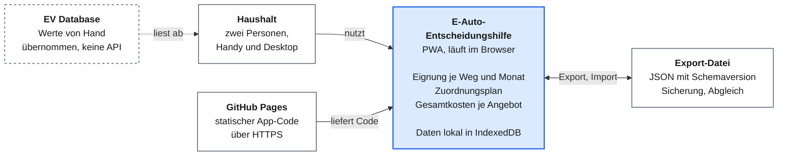
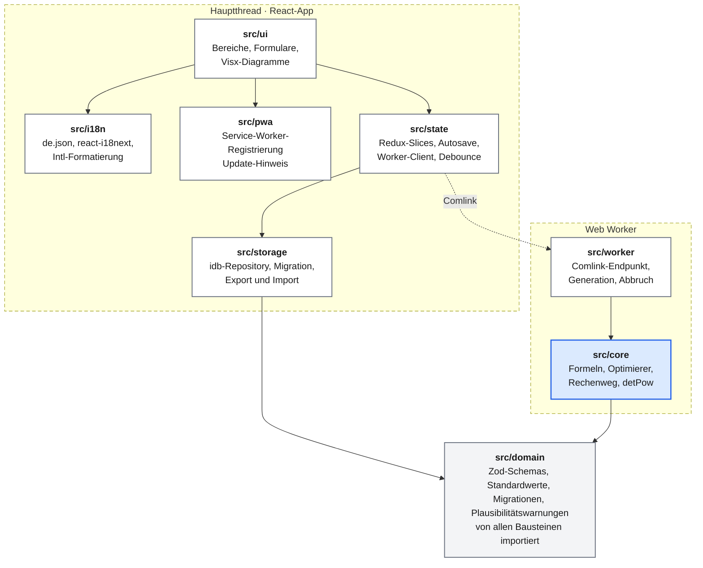
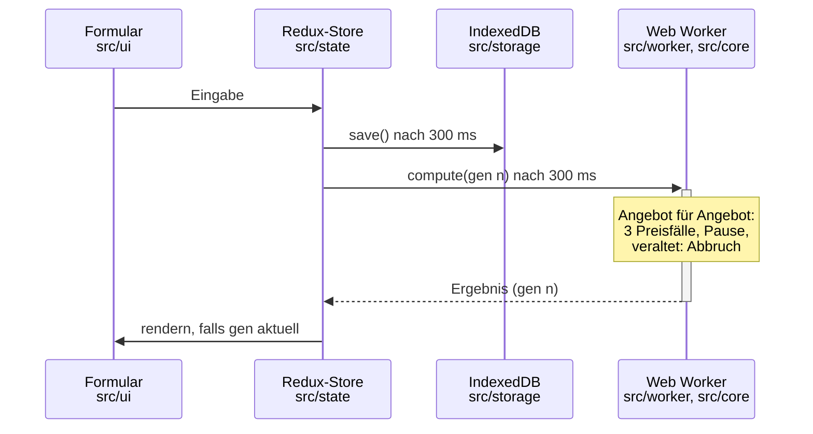
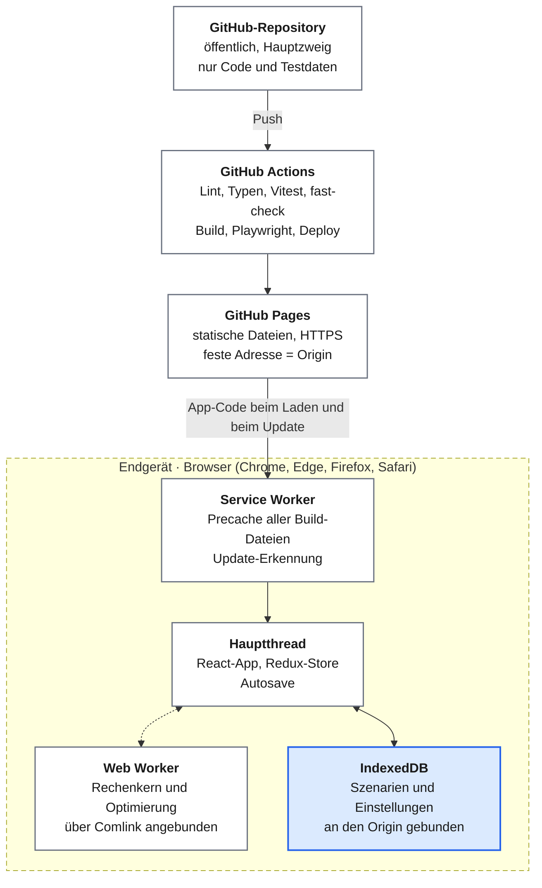

# Wattwahl – Architekturdokumentation (arc42)

Nov 13, 2026 · @Eduard Vodicka

## 1. Einführung und Ziele

Wattwahl wird als rein clientseitige React-PWA gebaut: Rechenkern im Web Worker, Daten in IndexedDB, Auslieferung über GitHub Pages. Fachliche Regeln, Formeln und Testfälle stehen ausschließlich in der Spezifikation: Wattwahl – E-Auto-Entscheidungshilfe. Dieses Dokument legt fest, wie sie technisch umgesetzt werden.

### 1.1 Aufgabenstellung

Für jedes Angebot (Kauf oder Leasingstufe) eines E-Auto-Kandidaten berechnet die App:

1. die Eignung für alle Arbeitswege in jedem Monat,
2. den kostenoptimalen Zuordnungsplan von E-Auto und Verbrenner je Tagestyp und Anwesenheitszustand,
3. die Gesamtkosten der Flotte über die Vergleichsdauer, mit Spanne über drei Preisfälle.

### 1.2 Qualitätsziele

| Prio | Qualitätsziel | Bedeutung für die Architektur |
| --- | --- | --- |
| 1 | Korrektheit und Nachvollziehbarkeit | Formeln in genau einem Modul, jede Ergebniszahl mit Rechenweg, alle 19 Testfälle automatisiert |
| 2 | Performance | 10 Kandidaten × 5 Angebote × 3 Preisfälle in ≤ 5 s am Handy und ≤ 2 s am Desktop, Oberfläche bleibt bedienbar |
| 3 | Datenhoheit und Robustheit | Daten verlassen das Gerät nur per Export. Fehlerhafte Eingaben oder Importe führen nie zu Absturz oder Datenverlust |
| 4 | Offline-Fähigkeit | Nach der Installation ohne Netz voll nutzbar, der Stand übersteht einen Neustart |
| 5 | Wartbarkeit | Rechenkern ohne UI-Abhängigkeiten, Grenzen per Lint-Regel erzwungen |

### 1.3 Stakeholder

| Rolle | Erwartung |
| --- | --- |
| Haushalt (zwei Personen, Nutzer) | Belastbarer Kostenvergleich auf Handy und Desktop, Daten bleiben privat |
| Entwicklung (auch KI-gestützt) | Eindeutige Bausteine, Schnittstellen und Testbasis als Vorgabe für die Implementierung |
| Betrieb (Eigentümer des Repositorys) | Kostenloses Hosting ohne Serverpflege |

## 2. Randbedingungen

Die Plattform ist durch die Spezifikation fest vorgegeben: statische Seite, kein Server, kein Netzwerkverkehr außer dem Laden der App.

### 2.1 Technisch

| Randbedingung | Folge für die Architektur |
| --- | --- |
| Hosting auf GitHub Pages im kostenlosen Plan, öffentliches Repository | Keine eigenen HTTP-Header (kein COOP/COEP, keine CSP per Header), kein SPA-Fallback, keine Nutzerdaten im Repository |
| Kein Server, keine Benutzerkonten, keine Live-Preise | Gesamte Logik im Browser, Geräteabgleich nur über Export-Datei |
| Keine Cookies, keine Analyse, keine Laufzeit-Abhängigkeit von externen Diensten | Alle Bibliotheken werden mitgebaut, keine CDN-Einbindung |
| Aktuelle Chrome, Edge, Firefox und Safari auf Desktop und Handy | Nur Web-Standards mit Unterstützung in allen drei Engines (Blink, Gecko, WebKit) (Web Worker, IndexedDB, Service Worker) |
| Stabile Adresse, weil der Browser-Speicher an den Origin gebunden ist | Der Origin ist `https://wattwahl.evodicka.dev` und wird nicht geändert, Vite-`base` ist fest `/` |
| Sprache Deutsch, Euro, Kilometer, Dezimalkomma | Formatierung über `Intl` mit Locale `de-DE`, Texte in einer Sprachdatei |

### 2.2 Organisatorisch

- Die Spezifikation ist fachlich verbindlich. Abweichungen werden dort geändert, nicht im Code entschieden.
- Build, Tests und Veröffentlichung laufen über GitHub Actions bei jedem Push auf den Hauptzweig.
- Alle Abhängigkeiten haben eine freie Lizenz und sind in `package.json` exakt gepinnt.

### 2.3 Konventionen

- TypeScript im Strict-Modus, ESLint und Prettier im CI verpflichtend.
- Code-Bezeichner auf Englisch, Fachbegriffe nach der Zuordnung im Glossar (Kapitel 12). Oberflächentexte nur auf Deutsch und nur über die Sprachdatei.
- Architekturdiagramme nach dem C4-Modell, Entscheidungen als ADR in Kapitel 9.

## 3. Kontextabgrenzung

Die App hat genau zwei technische Schnittstellen nach außen: das Laden des Codes von GitHub Pages und die Export-Datei.

**Systemkontext · 4 Nachbarn, 1 System**

*Nur App-Code kommt aus dem Netz, alle Daten bleiben auf dem Gerät. C4 Ebene 1 · Systemkontext.*

Die EV Database ist nur eine Quelle für den Nutzer (gestrichelt). Die App ruft sie nicht auf und importiert nichts von dort.

| Nachbar | Richtung | Inhalt | Technik |
| --- | --- | --- | --- |
| Haushalt | beidseitig | Eingaben, Ergebnisansichten | Browser-Oberfläche, Touch und Tastatur |
| GitHub Pages | zur App | HTML, JavaScript, CSS, Manifest, Icons | HTTPS GET, nur beim Laden und beim Update |
| Export-Datei | beidseitig | Szenarien mit Schemaversion | Download per Blob-URL, Auswahl per `<input type="file">` |
| EV Database | zum Haushalt | Reichweiten, Netto-Kapazität | keine, manuelle Übernahme |

## 4. Lösungsstrategie

Ein reiner, deterministischer Rechenkern läuft getrennt von der Oberfläche im Web Worker. Zod-Schemas sind die einzige Quelle für Datentypen, Speicherformat und Import.

### 4.1 Ziele und Ansätze

| Qualitätsziel | Ansatz | Details |
| --- | --- | --- |
| Korrektheit, Nachvollziehbarkeit | Formeln als reine Funktionen in `src/core/calc`, jede Funktion liefert Wert und Rechenweg-Eintrag | 8.4, 8.13 |
| Performance | Rechenkern im Web Worker, dynamische Programmierung nach Spezifikation, Optionsmengen werden geteilt | 6.1, 8.5 |
| Bedienbarkeit während der Rechnung | Debounce 300 ms, Generation-Token, kooperativer Abbruch zwischen Angeboten | 8.5 |
| Datenhoheit, Robustheit | IndexedDB lokal, Import nur über `JSON.parse` und Zod, Schreiben in einer Transaktion | 8.2, 8.3 |
| Offline | Precache aller Assets über vite-plugin-pwa, kein Netzwerkzugriff zur Laufzeit | 8.12 |
| Wartbarkeit | Ein Paket mit Schichten, Importgrenzen per ESLint, Fachbegriffe mit fester Code-Zuordnung | 5, 12 |

### 4.2 Technologie-Stack

| Bereich | Wahl |
| --- | --- |
| Sprache und Build | TypeScript (strict), Vite |
| UI | React mit React Router im Hash-Modus (`createHashRouter`) |
| UI-Zustand | Redux Toolkit mit React-Redux |
| Styling | CSS Modules, Design-Tokens als CSS Custom Properties |
| Diagramme | Visx (SVG) |
| Texte und Formate | react-i18next, `Intl.NumberFormat` mit `de-DE` |
| Worker-Anbindung | Comlink |
| Speicher | IndexedDB über idb |
| Schema und Validierung | Zod |
| Offline und Updates | vite-plugin-pwa (Workbox) |
| Tests | Vitest, React Testing Library, fast-check, Playwright, @axe-core/playwright |
| Qualität | ESLint mit Importgrenzen, Prettier |
| Auslieferung | GitHub Actions, GitHub Pages |

## 5. Bausteinsicht

Die App ist ein Paket mit acht Modulen unter `src/`. Abhängigkeiten laufen nur in Pfeilrichtung und werden per ESLint geprüft.

**Bausteine · 2 Container, 8 Module**

*Der Rechenkern hängt nur vom Domänenmodell ab. C4 Ebene 2 und 3 · Pfeil = darf importieren, gestrichelt = Thread-Grenze über Comlink.*

Die Oberfläche erreicht den Rechenkern nur über `src/state` und den Worker. `src/core` kennt weder React noch Browser-APIs und ist damit ohne DOM testbar.

### 5.1 Schnittstellen der Module

| Modul | Wichtige Dateien | Öffentliche Schnittstelle |
| --- | --- | --- |
| `src/domain` | `schema.ts`, `defaults.ts`, `offerId.ts`, `settings.ts`, `migrations.ts`, `validation.ts`, `result.ts` | `ScenarioSchema`, `ScenarioComputeSchema`, `CandidateComputeSchema`, `DeviceSettingsSchema`, `OfferResultSchema`, `TraceEntrySchema`, `SliderPricesSchema`, `CURRENT_SCHEMA_VERSION`, `migrate(data, context)` (Kontext mit dem Monat der Migration), `createScenarioTemplate(…)` (mit dem aktuellen Monat als Argument), `checkWarnings(scenario)` |
| `src/core` | `compute.ts`, `calc/`, `optimizer/`, `math/`, `trace.ts`, `hash.ts` | `computeOffer(scenario, offer, priceCase, { sliderPrices?, trace?, cache? })`, `ComputeCache`, `hashResult(value)`, `Trace` |
| `src/worker` | `core.worker.ts`, `endpoint.ts`, `index.ts` (`spawnCoreWorker()`) | ` compute({  ``generation, scenario, sliderPrices?` `})`, `explain({ scenario, offerId, priceCase, sliderPrices? })` über Comlink |
| `src/storage` | `repository.ts`, `exportImport.ts` | `loadAll()`, `save(scenario)`, `exportFile(ids)`, `parseImport(file)`, `writeImport(scenarios, mode)` |
| `src/state` | `store.ts`, `scenarioSlice.ts`, `resultSlice.ts`, `uiSlice.ts`, `listeners.ts`, `coreClient.ts`, `thunks.ts`, `selectors.ts`, `types.ts` | `createAppStore(…)`, `useAppSelector`, `useAppDispatch`, Thunks `requestCompute()` mit Debounce, `startApp()`, `importFile()`, `exportScenarios()`, `openTrace()` |
| `src/ui` | `areas/`, `components/`, `charts/`, `theme.css` | Routen aus 8.8 |
| `src/i18n` | `de.json`, `index.ts`, `format.ts` | `t()`, `formatEuro()`, `formatKm()`, `formatConsumption()` |
| `src/pwa` | `register.ts`, `install.ts` | `useUpdatePrompt()`, `isIosBrowserTab()` |

### 5.2 Rechenkern im Detail

Die Dateien in `src/core/calc` bilden die Abschnitte 1 bis 8 der Berechnungslogik der Spezifikation eins zu eins ab: `range.ts`, `soh.ts`, `suitability.ts`, `energy.ts`, `workdays.ts`, `extraMileage.ts`, `prices.ts`, `costs.ts`.

`src/core/optimizer` setzt den Algorithmus der Spezifikation in Schritten um: `problem.ts` (Szenario, Kandidat und Preisfall werden zu allgemeinen Entscheidungsgruppen, unabhängig vom Angebot), `thresholds.ts` (Schwellen-SoH je Option), `optionSets.ts` (Rasterwerte mit gleicher Optionsmenge), `knapsack.ts` (dynamische Programmierung auf den Entscheidungsgruppen), `warranty.ts` (Restgarantie und Garantie-Budget), `select.ts` (Zielkosten und Gleichstandsregel). Brute Force und Q4 laufen auf der Ebene der Entscheidungsgruppen, nicht auf ganzen Szenarien. `bruteForce.ts` liegt unter `src/core/optimizer/__tests__` und wird nicht ausgeliefert.

## 6. Laufzeitsicht

Vier Abläufe prägen die Architektur: Neuberechnung nach einer Eingabe, App-Start, Import und App-Update.

### 6.1 Eingabe bis Ergebnis

**Eingabe bis Ergebnis · 4 Beteiligte, 5 Nachrichten**

*Nur das Ergebnis der neuesten Eingabe erreicht die Ansicht. Laufzeitszenario 6.1 · von der Eingabe bis zum Ergebnis.*

Speichern und Rechnen starten unabhängig voneinander nach 300 ms Ruhe. Kommt während der Rechnung eine neue Eingabe, endet der alte Lauf beim nächsten Angebot mit `superseded` (8.5).

### 6.2 App-Start

1. Der Service Worker liefert die App aus dem Cache, auch ohne Netz.
2. Beim ersten Start wird `navigator.``storage.persist()` angefragt. Läuft die App dabei auf iOS nicht als installierte App, erscheint einmalig der Installationshinweis.
3. Das Repository lädt alle Szenarien, migriert ältere Versionen mit dem aktuellen Monat als Monat der Migration und prüft sie mit Zod.
4. Das aktive Szenario kommt aus `settings`. Gibt es keins, legt src/state ein leeres Szenario aus der Vorlage an.
5. Die erste Berechnung startet, die Export-Erinnerung wird geprüft.

### 6.3 Import

1. Der Nutzer wählt Datei und Modus (ersetzen oder hinzufügen).
2. Größe prüfen, `JSON.parse`, Format-Kennung `eauto-export` prüfen.
3. Jedes Szenario migrieren (aktueller Monat als Monat der Migration) und mit `safeParse` prüfen. Beim ersten Fehler erscheint die Meldung mit Pfad, es wird nichts geschrieben.
4. Beim Hinzufügen vergibt src/state neue IDs, dann werden alle Szenarien in einer Transaktion geschrieben. Was „Ersetzen“ entfernt und behält, steht in 8.3.
5. Die Stores laden neu, die Berechnung für das aktive Szenario startet.

### 6.4 App-Update

1. Der Service Worker findet eine neue Version und lädt sie im Hintergrund.
2. `useUpdatePrompt()` zeigt den Hinweis.
3. Bei „Aktualisieren“ wird sofort gespeichert, dann aktiviert der neue Service Worker und die Seite lädt neu.
4. Beim folgenden Start migriert das Repository gespeicherte Szenarien (6.2, Schritt 3).

## 7. Verteilungssicht

Es gibt genau eine Umgebung: GitHub Pages für die Dateien, das Endgerät des Nutzers für Rechnung und Speicherung.

**Verteilung · 3 GitHub-Dienste, 4 Laufzeit-Knoten im Browser**

*Der Server liefert nur Dateien, gerechnet und gespeichert wird im Browser. Verteilung · Build bei GitHub, Laufzeit auf dem Endgerät.*

Nach dem ersten Laden kommt die App aus dem Service-Worker-Cache. Die Daten in IndexedDB hängen an der Pages-Adresse, darum bleibt diese fest.

### 7.1 Pipeline

1. `npm ci`
2. Lint (ESLint mit Importgrenzen) und Typprüfung (`tsc --noEmit`)
3. Unit- und Property-Tests (Vitest mit fast-check)
4. Build mit Vite, vite-plugin-pwa erzeugt Manifest und Service Worker
5. End-to-End-Tests mit Playwright gegen `vite preview` in Chromium, Firefox und WebKit
6. Veröffentlichung mit `actions/upload-pages-artifact` und `actions/deploy-pages`, nur vom Hauptzweig

### 7.2 Konfiguration

- Vite `base` ist fest auf `/` gesetzt, der Service Worker nutzt den Scope `/`.
- Quelle von GitHub Pages ist „GitHub Actions“, nicht ein Branch. Die Custom Domain `wattwahl.evodicka.dev` ist in den Repository-Einstellungen gesetzt und HTTPS erzwungen. Eine `CNAME`-Datei im Repository ist bei dieser Quelle wirkungslos und wird nicht angelegt.
- Lokale Entwicklung mit `vite`, Vorschau des PWA-Builds mit `vite preview`.

## 8. Querschnittliche Konzepte

Die Konzepte gelten für alle Bausteine und sind die verbindliche Vorgabe für die Implementierung.

### 8.1 Domänenmodell und Typen

- Die Entitäten aus dem Abschnitt Datenmodell der Spezifikation sind Zod-Schemas in `src/domain/schema.ts`. TypeScript-Typen entstehen nur über `z.infer`, es gibt keine parallel gepflegten Interfaces.
- Das Szenario ist das Aggregat: Es wird als Ganzes geladen, gespeichert, exportiert und an den Worker übergeben.
- IDs sind UUIDs aus `crypto.randomUUID()` und werden nur in `src/state` erzeugt, nie im Rechenkern. Auch beim Import vergibt src/state die neuen IDs, bevor src/storage schreibt.
- Angebote haben keine eigene UUID. Die `offerId` wird abgeleitet: `<candidateId>:purchase` für den Kauf, `<candidateId>:lease:<leaseTierId>` für eine Leasingstufe. Die `leaseTierId` ist die UUID der Leasingstufe (von src/state vergeben), nicht ihre Kilometerstufe, damit die `offerId` stabil bleibt, wenn der Nutzer die Stufe ändert.
- Prozentwerte werden wie eingegeben gespeichert (15 bedeutet 15 %), nur der Rechenkern rechnet sie in Anteile um. Zeitpunkte sind ISO-Strings, Erstzulassung und Stichtag der Garantieberechnung sind `{ month, year }` mit ganzen Zahlen, denn der Kern kennt kein `Date` und Szenarien reisen als JSON. Die Erstzulassung ist bei gebraucht Pflicht (Rechenschema, 8.6).
- Den aktuellen Monat für den Stichtag liefert `src/state`, wie die UUIDs. `createScenarioTemplate` erhält ihn als Argument, `src/domain` und `src/core` lesen keine Uhr (ADR-17). Das Szenario merkt sich, ob der Nutzer den Stichtag selbst gesetzt hat, damit er nur dann als geändert gilt.
- Die Garantiefelder `vehicleWarranty` und `batteryWarranty` des Kandidaten enthalten die normale Garantie, nicht die Restgarantie. Die Restgarantie berechnet nur der Kern (`OPT.remainingWarranty`).
- Werte, die in der Parameterliste und in einer Entität der Spezifikation vorkommen, stehen an der Entität: Benzinpreise, Preissteigerung Benzin und Wartung des Verbrenners am Bestandsfahrzeug, freie Tage an der Arbeitsstätte. Wertverlust und Wartung des E-Autos sind Parameter, die der Kandidat überschreiben kann.
- Standardwerte der Parameterliste stehen in `src/domain/defaults.ts`. Jeder Wert trägt das Kennzeichen `placeholder`, `required` oder `fixed`, damit die Oberfläche Annahmen markieren kann.

### 8.2 Persistenz und Migration

- IndexedDB-Datenbank `eauto` mit zwei Stores: `scenarios` (Schlüssel `id`, Wert `{ id, schemaVersion, updatedAt, data }`) und `settings` (ein Eintrag mit aktivem Szenario, Datum des letzten Exports, Intervall der Export-Erinnerung, Farben, Kennzeichen für den ersten Start). settings bleibt auf dem Gerät und ist nicht Teil des Exports.
- Zugriff nur über `src/storage/repository.ts` auf Basis von idb. Kein anderer Baustein öffnet die Datenbank, eine ESLint-Regel verbietet `indexedDB` und `idb` außerhalb des Repositorys.
- Autosave: Eine Listener-Middleware von Redux Toolkit in src/state/listeners.ts ruft nach 300 ms Ruhe save() des Repositorys auf. Bei `visibilitychange` auf `hidden` und bei `pagehide` wird sofort geschrieben.
- Beim ersten Start wird `navigator.storage.persist()` angefragt. Eine Ablehnung erzeugt einen Hinweis, keinen Fehler.
- Migration: `src/domain/migrations.ts` enthält je Version eine reine Funktion `vN → vN+1`. Beim Laden und beim Import wird die Kette bis zur aktuellen Version angewandt, danach mit Zod geprüft und zurückgeschrieben. Jeder Schritt erhält einen Kontext mit dem Monat der Migration, den `src/storage` beim Laden und beim Import übergibt. Dafür nehmen `MigrationStep`, `createMigrator`, `migrate` und `upgradeScenario` den Kontext entgegen, die Schritte bleiben reine Funktionen.
- Aktuelle Schemaversion ist 2. Der Schritt v1 → v2 (Garantie ab Erstzulassung, Details in `docs/change-garantie.md`) setzt in jedem Szenario den Stichtag auf den Monat der Migration, als nicht vom Nutzer gesetzt. Neuwagen behalten ihre Garantiewerte. Bei Gebrauchten mit Erstzulassung wird die gespeicherte Restgarantie auf die normale Garantie zurückgerechnet (Dauer = Restjahre + a ÷ 12, Kilometer = Restkilometer + Laufleistung), sodass die Ableitung wieder die alte Restgarantie ergibt. Nicht umrechenbare Werte (ohne Erstzulassung, ohne Laufleistung, leere Garantiefelder) bleiben unverändert, der Kandidat erhält das Kennzeichen „Garantiewerte prüfen“. Der Migrationstest vergleicht die Restgarantie mit Toleranz (8.4), weil die Rückrechnung in Gleitkomma nicht immer bitgenau ist. Je Schemaversion liegt eine Beispieldatei im Repository. Ein Datensatz mit höherer Version als die App wird nur gelesen und mit Hinweis auf ein App-Update angezeigt. Das Repository schreibt nie über einen Datensatz mit höherer schemaVersion, Autosave ist dafür gesperrt.
- Mehrere Tabs: Die IndexedDB-Version folgt `CURRENT_SCHEMA_VERSION`. Öffnet ein Tab mit neuerer App die Datenbank, erhalten ältere Tabs `versionchange`, schließen ihre Verbindung und bitten um Neuladen. Schreibversuche danach liefern einen Status statt eines Fehlers. Findet eine ältere App die Datenbank schon in einer neueren Version vor, öffnet sie sie ohne Versionsangabe und nur lesend: Sie zeigt die Daten mit Hinweis auf ein App-Update und schreibt nichts.

### 8.3 Export und Import

- Exportformat: `{ format: "eauto-export", schemaVersion, exportedAt, scenarios: [...] }`. Dateiname `eauto-export-JJJJ-MM-TT-vN.json`, wahlweise ein oder alle Szenarien.
- Import liest die Datei nur mit `JSON.parse`, prüft die Größe (höchstens 1 MB, festgelegt in S13), migriert und validiert mit `safeParse`. Dateien mit höherer schemaVersion als die App werden abgelehnt, ebenso Dateien ohne Szenario und Dateien mit einer ID doppelt. Fehler nennen einen Code (`tooLarge`, `invalidJson`, `wrongFormat`, `newerVersion`, `invalidFile`, `noScenarios`, `invalidScenario`, `duplicateId`) und den Pfad im Schema, zum Beispiel `scenarios[0].candidates[2].price`.
- „Ersetzen“ und „Hinzufügen“ schreiben in einer einzigen IndexedDB-Transaktion. Bei einem Fehler wird nichts geändert. „Ersetzen“ entfernt nur die Szenarien, die die App lesen kann. Datensätze einer neueren App bleiben erhalten, ein Import mit derselben ID wird abgewiesen. Datensätze, die sich nicht laden lassen, bleiben ebenfalls erhalten, außer die Datei bringt ein Szenario mit derselben ID. Eine beim Hinzufügen schon vergebene ID bricht die Transaktion mit `ConstraintError` ab, das ist ein Programmfehler, weil die IDs aus `crypto.randomUUID()` stammen. Der Export enthält nur Szenarien, die die App lesen kann, und nennt die übrigen (`skipped`), damit die Oberfläche darauf hinweist. Beim Hinzufügen erhalten Szenarien neue IDs aus src/state, doppelte Namen den Zusatz „(Import)“.
- Die Export-Erinnerung vergleicht das gespeicherte Exportdatum mit dem Intervall aus settings (Standard 14 Tage).

### 8.4 Rechenkern und Determinismus

- `src/core` enthält nur reine Funktionen. Verboten sind dort per ESLint: `Date`, `Math.random`, `performance`, `Math.pow`, `Math.exp`, `Math.log`, der Operator `**`, DOM-Zugriffe und Importe von außerhalb src/core außer aus `src/domain`.
- Gerechnet wird in float64 nur mit den Grundrechenarten sowie `min`, `max`, `floor` und `ceil`, die IEEE 754 in allen Engines gleich rundet. Potenzen liefert `src/core/math/detPow.ts`: ganzzahlige Exponenten per Quadrieren und Multiplizieren, Zwölftel-Exponenten wie (1 − w)^(D/12) über eine zwölfte Wurzel mit Newton-Verfahren und fester Schrittzahl. Damit sind Ergebnisse in allen Browsern bitgleich (ADR-10).
- Gerundet wird nur in der Anzeige über `src/i18n/format.ts`, nie im Kern.
- Die Testfälle der Spezifikation sind von Hand gerundet und werden darum mit Toleranz verglichen: je Erwartungswert ± eine halbe Einheit seiner letzten angegebenen Stelle, zum Beispiel 0,2501 ± 0,00005 und 31,1 km ± 0,05 km. Der Determinismus-Test (Q5) vergleicht exakt.
- Jede Formelfunktion schreibt in ein optionales `Trace`-Objekt (Formel-ID nach Spezifikation, Eingaben, Ergebnis). Daraus entsteht die Ansicht Rechenweg. Jeder Eintrag kann über `resultPath` auf ein Feld des Ergebnisses verweisen (Q6).
- Ergebnis, Trace-Eintrag und Preis-Regler-Werte sind Zod-Schemas in `src/domain/result.ts`, damit Kern, Worker, Zustand und Oberfläche dieselben Typen nutzen.
- Formel-IDs haben die Form `F<Abschnitt>.<Name>` (Abschnitt der Berechnungslogik 1 bis 8), Schritte des Optimierers `OPT.<Name>`:

| Abschnitt | IDs |
| --- | --- |
| 1 Reichweite | F1.w, F1.wStar, F1.R, F1.RStar |
| 2 SoH | F2.slope, F2.soh, F2.kEnd |
| 3 Eignung | F3.u, F3.phi, F3.n, F3.suitable, F3.reserveKm, F3.reservePct, F3.trafficLight |
| 4 Energie | F4.c, F4.E, F4.Egrid, F4.evDayCost, F4.iceDayLitres, F4.maintKm |
| 5 Arbeitstage | F5.f, F5.c, F5.days |
| 6 Zusatzstrecke | F6.share |
| 7 Preise | F7.qy, F7.Fb, F7.Fs, F7.Fm |
| 8 Gesamtkosten | F8.purchase, F8.lease, F8.extraKm, F8.underKm, F8.energy, F8.maintenance, F8.kIce, F8.iceOdometer |
| Optimierer | OPT.threshold, OPT.optionSet, OPT.remainingWarranty, OPT.budget, OPT.target, OPT.select, OPT.budgetExtraCost, OPT.yearsToKmLimit |

- Dynamische Programmierung: Achse sind die jährlichen E-Auto-Kilometer in Zellen von 1 km (Konstante `DP_CELL_KM`). Der Kilometerwert jeder Option wird für die Achse auf eine ganze Zelle aufgerundet. Die DP merkt sich je Zelle zusätzlich die exakten Kilometer des günstigsten Plans (bei exakt gleichen Kosten gewinnt der Plan mit weniger Kilometern). Garantie-Budget, Leasingkosten und die Regel „kleinere E-Auto-Strecke“ rechnen mit diesen exakten Kilometern, damit ein Plan nicht wegen der Rundung abgewiesen oder falsch bewertet wird. Nur die Zuordnung zum SoH-Rasterwert nutzt den aufgerundeten Wert: Er liefert einen SoH, der höchstens dem exakten entspricht, jede dort zulässige Option ist also auch für den exakten Wert zulässig. Ausgewiesen werden K\_EV, Kosten und Reserve des gewählten Plans mit exakten Werten. Brute Force löst dieselbe diskretisierte Aufgabe und wendet die Auswahlregeln unabhängig an, Q4 vergleicht Strecke, Kosten und Budgetergebnis.
- Gleichstand: Alle Zellen mit Zielkosten ≤ Minimum + 0,01 € bilden die Kandidaten. Dann gewinnt die größere kleinste Reserve über alle besuchten Wege und zwölf Monate, danach die kleinere E-Auto-Strecke.
- Ungeeignet: Ein Angebot ist geeignet, wenn mindestens ein Rasterwert eine zulässige Lösung hat. Sonst wird der Grund beim SoH der kleinsten erzwungenen E-Auto-Strecke berechnet. Der Streng-Modus verlangt zusätzlich, dass jeder besuchte Weg im gewählten Rasterwert zulässig ist.
- Die Jahresanteile q\_y werden in Jahren gemessen: q\_y = min(12, D − 12(y−1)) / 12. Wo die Spezifikation 52 schreibt, gilt der Parameter Arbeitswochen pro Jahr.

### 8.5 Neuberechnung und Nebenläufigkeit

- Worker-Schnittstelle über Comlink: ` compute(request: {  ``generation, scenario, sliderPrices?` `}): Promise<ComputeResult | { status: "superseded" }>`.
- `sliderPrices` enthält die Werte des Preis-Reglers aus `uiSlice.ts` (`petrol`, `electricity`, `petrolEscalationPct`, `electricityEscalationPct`, Schema `SliderPricesSchema`) und wird nicht gespeichert. Der Kern erhält sie als Option von `computeOffer`. Ist der Regler aktiv, rechnet der Worker zusätzlich den Preisfall `slider`. „Als Szenario speichern“ legt die Werte als neues Szenario ab.
- Der Hauptlauf rechnet ohne Trace. Öffnet der Nutzer den Rechenweg, rechnet `explain({ scenario, offerId, priceCase, sliderPrices? })` genau dieses Angebot mit Trace nach. Der Store hält nur den Trace des geöffneten Angebots.
- `computeOffer` liefert je Angebot und Preisfall ein Ergebnis mit Status `ok`, `incomplete` (Feldpfade der fehlenden Pflichtfelder, etwa `candidates[2].purchasePrice` oder bei einem Gebrauchten ohne Erstzulassung `candidates[2].firstRegistration`; ein unvollständiges Leasingangebot macht alle Angebote des Kandidaten unvollständig, eine Lücke im Fahrprofil alle Kandidaten) oder `unsuitable` (Grund: Wochentag und Monat mit beiden Reserven, im Streng-Modus Weg und Monat, oder die SoH-Kopplung). Das Schema `OfferResultSchema` steht in `src/domain/result.ts`. Mit Trace verweist jede Zahl eines `ok`-Ergebnisses über `resultPath` auf ihren Rechenweg-Eintrag (Q6, Monate als Beschriftung ausgenommen). Das Ergebnis ist mit und ohne Trace gleich. Die kleinste Reserve (`minReserve`) gilt nur für Wege und Monate, in denen der Plan das E-Auto fahren lässt, und ist `null`, wenn es nie fährt; die 24 Zellen der Heatmap zeigen alle Wege. Es nennt `scenarioId` und `comparisonMonths`, damit eine Ansicht auch während einer Neuberechnung sagt, wofür sie gilt, und zeigt die Jahre bis zur Kilometergrenze beider laufenden Garantien immer, nicht erst bei überschrittenem Budget. `OfferResult.warranty.remaining` nennt die berechnete Restgarantie beider Garantien (Restjahre und Restkilometer) mit Rechenweg-Eintrag `OPT.remainingWarranty` (Q6). Budget, Ablaufprüfung und Jahre bis zur Kilometergrenze rechnen mit diesen Restwerten, auch bei Leasingangeboten, bei denen das Budget nicht aktiv ist. `computeOffer` prüft die Reglerwerte mit `SliderPricesSchema` und weist ungültige Werte ab.
- Ein `ComputeCache` teilt die Prüfung des Szenarios und je Kandidat und Preisfall das Problem samt dynamischer Programmierung zwischen allen Angeboten desselben Kandidaten. Der Cache merkt sich das Szenario-Objekt und beginnt neu, sobald er ein anderes erhält. Darum wird der Szenario-Zustand bei jeder Änderung ersetzt und nie an Ort und Stelle geändert. Für den Preis-Regler hält er je Kandidat nur das Problem der zuletzt verwendeten Reglerwerte. Aufrufe mit Trace nutzen ihn nicht, damit ihr Rechenweg vollständig ist.
- Der Thunk requestCompute() in src/state wartet nach der letzten Eingabe 300 ms und sendet dann mit hochgezählter `generation`.
- Der Worker merkt sich die höchste empfangene `generation`. Zwischen zwei Angeboten gibt er mit einem Macrotask (`MessageChannel`) die Kontrolle ab, damit neue Aufrufe ankommen, und bricht ab, wenn seine `generation` veraltet ist.
- `SharedArrayBuffer` und `Atomics` werden nicht genutzt, weil GitHub Pages die nötigen COOP/COEP-Header nicht setzt.
- Die Oberfläche übernimmt nur Ergebnisse mit der aktuellen `generation`. Bis dahin bleibt das letzte Ergebnis sichtbar und ist als „wird aktualisiert“ markiert.

### 8.6 Eingabe und Validierung

- Zahlenfelder speichern `number`. `parseDecimal` akzeptiert Komma und Punkt (Punkt mit genau drei Ziffern danach ist ein Tausenderpunkt, Regeln in der Spezifikation, Abschnitt Validierung) und liefert bei ungültiger Eingabe einen Fehlercode statt `NaN`. Die Oberfläche übersetzt den Code in einen Text der Sprachdatei.
- Typ und Bereich prüft das Speicherschema ScenarioSchema, es lässt leere Pflichtfelder (`null`) zu. Pflichtfelder prüft der Kern mit den strengen Rechenschemas: je Kandidat mit CandidateComputeSchema, für Fahrprofil und Parameter mit ScenarioComputeSchema (das Szenario ohne Kandidaten). Feldübergreifende Regeln (Minimum ≤ Mittel ≤ Maximum, Wegsumme > 0, freie Tage ≤ Arbeitstage, T\_kalt < T\_mild, Erstzulassung Pflicht bei gebraucht) stehen nur in den Rechenschemas. Das Speicherschema prüft nur Typ, Bereich und Struktur (höchstens vier Leasingstufen, je Kilometerstufe eine), damit ein gespeicherter Zwischenstand immer ladbar bleibt. Plausibilitätswarnungen (kalt > mild, > 200 kWh, Weg > 300 km, Erstzulassung nach dem Stichtag) sind eigene Funktionen in `src/domain/validation.ts` und blockieren nicht. Die Oberfläche ruft sie beim Verlassen eines Feldes direkt auf, ohne Worker.
- Der Kern prüft jeden Kandidaten einzeln gegen das Rechenschema. Ein fehlerhafter Kandidat erhält den Status `incomplete` mit Feldpfaden, die anderen werden normal berechnet.

### 8.7 Texte und Formatierung

- react-i18next mit statisch eingebundener Ressource `src/i18n/de.json`, ein Namespace je Bereich. Schlüssel sind per TypeScript-Modulerweiterung typisiert, fehlende Schlüssel brechen den Build.
- Zahlen, Währung und Prozent formatiert nur `src/i18n/format.ts` mit `Intl.NumberFormat("de-DE")`: Kosten in vollen Euro, Reserve in ganzen km, Verbrauch mit einer Nachkommastelle.

### 8.8 Oberfläche und Navigation

| Route | Bereich |
| --- | --- |
| `#/fahrprofil` | Bestandsfahrzeug, Arbeitsstätten A und B, Zusatzstrecke |
| `#/kandidaten`, `#/kandidaten/:id` | Kandidatenliste, Formular mit Leasingangeboten |
| `#/parameter` | Alle Rechenparameter mit Zurücksetzen je Feld |
| `#/ergebnis`, `#/ergebnis/:offerId` | Ergebnistabelle, Detailansichten, Preis-Regler |
| `#/szenarien` | Szenarioliste, Szenariovergleich, Export und Import |

- Layout-Umschaltung bei 900 px Breite: Seitenleiste und zwei Spalten darüber, untere Navigation darunter.
- Zwei Zwischenstufen für Tablets ändern nur Breiten und Spalten innerhalb der Layouts, keine Navigation:

  | Breite | Layout | Regeln |
  | --- | --- | --- |
  | unter 600 px | Handy | eine Spalte, untere Navigation |
  | 600 bis 899 px | Handy, breit | Inhalt höchstens 720 px und mittig, Kopfzeile und untere Navigation volle Breite. Formularkarten mit zwei Feldern je Zeile, Ergebniskarten und Preis-Regler zweispaltig, Kostenbalken mit Beschriftung links. |
  | 900 bis 1199 px | Desktop, schmal | Seitenleiste 200 px, Ränder 24 px, zwei Spalten. Feldgruppen mit drei Feldern untereinander. Ergebnistabelle mit Mindestbreite 880 px in einer Scrollbox, erste Spalte `position: sticky`. |
  | ab 1200 px | Desktop | Seitenleiste 240 px, zwei Spalten, Dreiergruppen nebeneinander |

- Die Stufen stehen als Media Queries in `src/ui/theme.css` (Breakpoints als Konstanten 600, 900 und 1200 px). Referenz sind die Tablet-Boards T1 bis T4 aus D3.
- Design-Tokens in `src/ui/theme.css` als Custom Properties, Hell und Dunkel über `prefers-color-scheme`. Vom Nutzer gewählte Ampelfarben überschreiben die Tokens zur Laufzeit am Wurzelelement.
- Ampelwerte zeigen immer Farbe plus Symbol oder Zahl. Bedienelemente am Handy mindestens 44 px hoch.

### 8.9 Visualisierung

- Diagramme sind React-Komponenten in `src/ui/charts` auf Basis von Visx: Kostenbalken mit Spannenstrich, Reserve-Heatmap, Zuordnungsraster, Szenariovergleich.
- Jede Diagrammkomponente in src/ui/charts wird einzeln mit `React.lazy` nachgeladen, damit Visx nicht im Start-Bundle liegt.
- Jedes Diagramm hat eine Tabellen- oder Textalternative für Screenreader.

### 8.10 Fehlerbehandlung

- Je Bereich eine Error Boundary. Ein Fehler in einer Ansicht lässt die anderen Bereiche bedienbar.
- Stürzt der Worker ab, wird er neu erzeugt. Das letzte Ergebnis bleibt als veraltet markiert sichtbar.
- `QuotaExceededError` beim Speichern führt zu einer Meldung mit Export-Aufforderung. Der Zustand im Speicher bleibt erhalten.

### 8.11 Sicherheit und Datenschutz

- Content Security Policy als `<meta>`-Tag, weil GitHub Pages keine Header erlaubt: `default-src 'self'; script-src 'self'; worker-src 'self'; connect-src 'self'; img-src 'self' data:; object-src 'none'; base-uri 'self'`.
- Die Richtlinie wird nur im Build in `index.html` eingefügt (`build/html.ts`), als erstes Element im Kopf, weil sie nur gilt, was nach ihr kommt. Der Entwicklungsserver braucht Inline-Skripte für das Neuladen. `assetsInlineLimit: 0` hält Schriften und kleine Dateien als Dateien, denn `font-src data:` ist nicht erlaubt.
- Kein `eval`, kein `dangerouslySetInnerHTML`. Importierte Inhalte werden nur als Text gerendert. Zod 4 erzeugt zur Laufzeit Code mit `new Function` und prüft das mit einer Probe, die die Richtlinie als Verstoß meldet. `src/domain/zodConfig.ts` schaltet das mit `z.config({ jitless: true })` ab, bevor das erste Schema läuft.
- Das Repository enthält nur Code und fiktive Testdaten.

### 8.12 Offline und Updates

- vite-plugin-pwa mit `registerType: "prompt"`: Alle Build-Artefakte werden vorab gecacht. Liegt eine neue Version bereit, zeigt die App einen Hinweis mit „Aktualisieren“.
- Manifest mit `name: "Wattwahl"`, `short_name: "Wattwahl"`, `display: "standalone"` und `start_url: "./#/"`. Auf iOS zeigt der erste Start eine Anleitung zur Installation auf dem Home-Bildschirm (`isIosBrowserTab()`: iPhone oder iPad im Browser, nicht als installierte App). Der erste Start zeigt einmal einen Willkommenshinweis (Z18, Z09); danach steht `firstRunCompleted` in den Geräteeinstellungen.
- „Aktualisieren“ ruft `saveBeforeUpdate()` auf. Konnten Änderungen nicht gespeichert werden (Speicher voll), lädt die App nicht neu und sagt es. In einer Datenbank einer neueren App wird nichts geschrieben, dort ist das Update erlaubt, weil es der Ausweg ist. Der Dienst-Worker prüft zusätzlich jede Stunde, ob es eine neue Version gibt.
- Der Build schreibt `<meta name="build-id">` (`BUILD_ID` aus der Umgebung, sonst `local`). Zwei Builds unterscheiden sich so in `index.html`; der End-to-End-Test für das Update baut Build B mit `BUILD_ID=b` nach `dist-b` und tauscht ihn hinter demselben Server aus.

### 8.13 Teststrategie

| Ebene | Werkzeug | Inhalt |
| --- | --- | --- |
| Unit | Vitest | Testfälle 1 bis 19 der Spezifikation gegen `src/core`, Migrationen gegen gespeicherte Beispieldateien jeder Version |
| Property | fast-check mit Vitest | Dynamische Programmierung gegen Brute Force auf zufälligen kleinen Fällen, Invarianten wie Reserve > 0 bei Eignung |
| Komponenten | Vitest, React Testing Library | Formulare, Validierungsmeldungen, Dezimalkomma |
| End-to-End | Playwright | Export, Speicher leeren, Import (Testfall 14), Offline nach Installation, Viewports 1280, 1024, 820 und 390 px, Laufzeitmessung mit 10 Kandidaten, Eingabe während der Rechnung (Q2), Ergebnis-Hash in drei Engines (Q5), persistenter Kontext (Q8), axe-Prüfung (Q10) |
| Manuelle Abnahme | iPhone mit Safari, Android-Mittelklasse-Handy mit Chrome | Laufzeit Q1 am echten Gerät, Installation und Offline-Start (Q9), Daten nach Geräteneustart (Q8); vor der Abnahme und nach größeren Änderungen |

Die Pipeline in GitHub Actions bricht bei Lint-, Typ- oder Testfehler ab und veröffentlicht nur einen grünen Build. Die axe-Prüfung der Diagrammseite läuft in Firefox nicht, siehe 11.2.

## 9. Architekturentscheidungen

ADR-01 stammt aus der Spezifikation, ADR-02 bis ADR-15 wurden am 13.11.2026 abgestimmt, ADR-16 bei der Freigabe G2 nach dem Benchmark, ADR-17 am 14.11.2026 mit der Garantie-Änderung nach dem Design-Review. ADR-03 und ADR-10 wurden in einer zweiten Runde festgelegt.

| ADR | Entscheidung | Kontext | Verworfene Alternativen | Konsequenz |
| --- | --- | --- | --- | --- |
| 01 | Statische PWA auf GitHub Pages, keine Server-Komponente | Daten sollen privat und lokal bleiben, Hosting kostenlos | Eigenes Backend, Cloud-Speicher | Geräteabgleich nur über Export-Datei, keine Header-Konfiguration |
| 02 | React als UI-Framework | Spezifikation ließ Preact oder React offen | Preact, SolidJS, Svelte | Größtes Ökosystem, größeres Start-Bundle als Preact |
| 03 | Redux Toolkit für den UI-Zustand | Szenario, Auswahl und Ergebnisse müssen über Bereiche geteilt werden | Zustand, Context mit Hooks, Signals | Feste Struktur mit Slices, Redux DevTools, Autosave über `createListenerMiddleware`. Mehr Boilerplate, im Store nur serialisierbare Daten |
| 04 | Hash-Routing mit `createHashRouter` | GitHub Pages hat keinen SPA-Fallback | History-API mit 404-Trick, kein Routing | Deep-Links und Zurück-Taste funktionieren offline, URLs enthalten `#` |
| 05 | CSS Modules mit Custom Properties | Hell/Dunkel und einstellbare Ampelfarben | Tailwind, globales CSS | Gekapselte Styles, Theme zur Laufzeit änderbar |
| 06 | Rechenkern im Web Worker, Anbindung über Comlink | Optimierung darf die Oberfläche nicht blockieren | Eigenes postMessage-Protokoll, Rechnen im Hauptthread | Asynchrone, typisierte Aufrufe, Daten werden per Structured Clone kopiert |
| 07 | Debounce 300 ms und Generation-Token | Live-Neuberechnung bei schnellen Eingaben | Worker hart beenden, Cache je Angebot | Abbruch nur zwischen Angeboten, kein Worker-Neustart |
| 08 | IndexedDB über idb, ein Datensatz je Szenario | Autosave und Migration je Szenario | Dexie, native API | Migrationen bleiben eigene reine Funktionen |
| 09 | Zod als einzige Schemaquelle | Typen, Speicherformat und Import müssen übereinstimmen | Valibot, JSON Schema mit Ajv, handgeschrieben | Typen aus `z.infer`, Fehler mit Pfad, größeres Bundle als Valibot |
| 10 | float64 mit eigener Potenzfunktion `detPow` | Spezifikation fordert bitgleiche Ergebnisse | `Math.pow` (nur je Engine bitgleich), Cent-Arithmetik | Bitgleich in allen Browsern wie gefordert. Math.pow und \*\* sind im Kern per Lint verboten, etwas mehr eigener Code |
| 11 | Visx für Diagramme | Spezifikation verlangt SVG | Eigene SVG-Komponenten, d3-scale mit eigenem SVG | Fertige Bausteine für Achsen, Heatmap und Tooltip, Diagramme werden einzeln nachgeladen |
| 12 | react-i18next mit `Intl.NumberFormat` | Texte in einer Sprachdatei, später weitere Sprachen | Eigenes Modul, FormatJS | Pluralregeln und Interpolation fertig, zusätzliches Bundle |
| 13 | vite-plugin-pwa (Workbox) | Offline-Betrieb und Update-Hinweis | Eigener Service Worker | Precache-Liste aus dem Build, Update-Prompt ohne eigenen Cache-Code |
| 14 | Ein Paket mit Schichten und ESLint-Importgrenzen | Rechenkern muss frei von UI bleiben | pnpm-Workspace mit getrennten Paketen | Einfaches Setup, Grenzen nur so stark wie die Lint-Regel |
| 15 | Vitest, fast-check und Playwright | 19 Testfälle, DP gegen Brute Force, Offline und Viewports | Nur Vitest, ohne Property-Tests | Drei Werkzeuge im CI, Playwright braucht Browser-Installation im Runner |
| 16 | Q1 nach dem Benchmark (G2): DP-Zelle bleibt 1 km, Ergebnisse je Kandidat werden nicht wiederverwendet | Q1 ist gemessen und erfüllt (11.1). Gröbere Zellen und Teilneuberechnung sind als Hebel dokumentiert | Sofort 5 km Zellen, Ergebnisse unveränderter Kandidaten behalten | Genaueste Rechnung, größter Aufwand pro Lauf. Reserve gegenüber den Grenzen ist begrenzt (Firefox 83 % von 2 s, gedrosselt 68 % von 5 s), der Handy-Test in S26 entscheidet, ob ein Hebel nötig wird |
| 17 | Stichtag der Garantieberechnung als Parameter des Szenarios statt Uhr im Kern | Die Restgarantie hängt vom Alter ab, der Kern darf keine Uhr lesen (Q5, 8.4) | Uhr im Kern, aktueller Monat aus `src/state` bei jeder Rechnung, Restgarantie weiter als Eingabe | Dasselbe Szenario liefert auch später dasselbe Ergebnis. Der Stichtag wird beim Anlegen mit dem aktuellen Monat vorbelegt und gilt nur als geändert, wenn der Nutzer ihn gesetzt hat, dafür ein Kennzeichen im Szenario. Der Nutzer muss den Stichtag selbst nachführen |

## 10. Qualitätsanforderungen

Jedes Szenario ist prüfbar und einem Test oder einer Messung zugeordnet. Die Werte stammen aus den nicht-funktionalen Anforderungen der Spezifikation. Die Spalte „Nachweis“ nennt, was davon bereits belegt ist (Stand nach S11 und der Freigabe G2). Sie wird mit jedem Schritt nachgeführt, und „Offen“ heißt, dass der Nachweis noch aussteht.

| ID | Qualität | Szenario | Prüfung | Nachweis |
| --- | --- | --- | --- | --- |
| Q1 | Performance | 10 Kandidaten mit Kauf und 4 Leasingstufen, 3 Preisfälle, Preis-Regler aus: Ergebnis in ≤ 5 s am Mittelklasse-Handy, ≤ 2 s am Desktop | Playwright-Messung, Handy mit CPU-Drosselung, Abnahme am echten Gerät | **Erfüllt** in der Messung (S11, 11.1): Desktop 0,8 bis 1,7 s, gedrosselt 3,4 s. Offen: fertige App (S24), echtes Handy (S26) |
| Q2 | Bedienbarkeit | Während Q1 läuft, reagiert ein Tastendruck im Formular ohne spürbare Verzögerung | Playwright: Eingabe während der Rechnung | Offen (S24), braucht Worker und Oberfläche (S14, S17) |
| Q3 | Korrektheit | Testfälle 1 bis 19 liefern die erwarteten Werte innerhalb der Toleranz aus 8.4 | Vitest im CI | **Teilweise:** Testfälle 1 bis 13, 16 und 17 grün (S07 bis S09), Testfall 15 Teil Einlesen (S04), Testfälle 18 und 19 zur Restgarantie (C1b). Testfall 14 Unit-Teil grün (S13). Offen: Testfall 14 End-to-End (S22), Testfall 15 Oberfläche (S17) |
| Q4 | Korrektheit Optimierer | DP und Brute Force liefern auf 100.000 zufälligen kleinen Fällen dieselben Kosten | fast-check im CI | **Erfüllt** (S09): 100.000 Fälle grün, Lauf etwa 2,3 s lokal und etwa 8 s im CI (G2) |
| Q5 | Determinismus | Dieselbe Eingabe ergibt in Chromium, Firefox und WebKit bitgleiche Ergebnisse | Playwright: Hash des Ergebnisses in allen drei Engines gleich | **Teilweise:** zwei Läufe in Node gleich (S10), Hash in Node, Chromium, Firefox und WebKit gleich (S11), auch durch den echten Worker und gleich dem direkten Aufruf (S14). Offen: Prüfung im CI (S24) |
| Q6 | Nachvollziehbarkeit | Jede Zahl der Ergebnistabelle hat einen Rechenweg-Eintrag mit Formel-ID | Unit-Test über alle Ergebnisfelder | **Erfüllt** im Kern (S10): jede Zahl eines Ergebnisses hat genau einen Eintrag mit demselben Wert. Oberfläche offen (S21) |
| Q7 | Robustheit | Import einer beschädigten oder fremden Datei ändert keinen gespeicherten Datensatz und nennt die Fehlerstelle | Vitest und Playwright | **Teilweise:** Unit-Teil grün (S13). Offen: End-to-End (S22) |
| Q8 | Persistenz | Nach Neuladen, Schließen des Browsers und Geräteneustart ist der Stand vollständig da | Playwright mit persistentem Kontext, Geräteneustart manuell | Offen (S24 automatisiert, S26 am Gerät) |
| Q9 | Offline | Die installierte App startet und rechnet ohne Netz | Playwright offline, Installation manuell auf iPhone und Android | Offen (S23, S24 automatisiert, S26 am Gerät) |
| Q10 | Barrierefreiheit | Alle Bereiche per Tastatur bedienbar, Kontrast WCAG AA | axe-Prüfung in Playwright | Offen (S16 bis S23 je Bereich, S24 gesamt) |
| Q11 | Wartbarkeit | Ein Import von `src/ui` nach `src/core` schlägt im Lint fehl | ESLint im CI | **Erfüllt** (S01): Lint-Test mit Fixture, ein Import von `src/ui` nach `src/core` schlägt fehl |

Q4 nutzt 100.000 Fälle (bei G2 festgelegt). Der Lauf dauert auf einem Laptop etwa 2,3 s und auf dem CI-Runner etwa 8 s und bleibt damit unter der Grenze von einer Minute. Weil Vitest Tests standardmäßig nach 5 s abbricht, hat dieser Test eine eigene Frist von 60 s, und die Einheitentests insgesamt 30 s.

## 11. Risiken und technische Schulden

Das größte technische Risiko ist die Laufzeit der Optimierung am Handy, das größte fachliche der Datenverlust im Browser-Speicher. Fachliche Modellgrenzen stehen in der Spezifikation und werden hier nicht wiederholt.

| Risiko | Wirkung | Maßnahme |
| --- | --- | --- |
| Optimierung überschreitet 5 s am Handy | Q1 verfehlt, Live-Neuberechnung wirkt träge | Früher Benchmark mit 10 Kandidaten ist gelaufen und erfüllt Q1 (11.1). Optionsmengen werden geteilt und die Kostentabellen sind `Float64Array`. Weitere Hebel mit gemessener Wirkung stehen in 11.1, falls der Handy-Test in S26 sie braucht |
| Abbruch nur zwischen Angeboten | Bei sehr großen Angeboten läuft eine veraltete Rechnung zu Ende | Angebote sind klein genug, Messung in Q2. Bei Bedarf Abbruchpunkte zusätzlich je Rasterwert |
| Safari löscht Daten nicht installierter Seiten nach etwa 7 Tagen | Verlust aller Szenarien auf dem iPhone | Installationshinweis beim ersten Start, Export-Erinnerung, `navigator.``storage.persist()` |
| Eigene Potenzfunktion `detPow` weicht von `Math.pow` ab oder ist langsamer | Abweichung von den Handrechnungen, längere Rechenzeit | Property-Test gegen `Math.pow` mit relativer Toleranz 1e-12, Laufzeit in Q1 mitmessen |
| Bundle aus React, Visx, Zod und i18next ist am Handy groß | Langsamer Erststart | Diagramme einzeln nachladen, Bundle-Budget im CI prüfen (250 KB gzip für die Start-Chunks, 11.1) |
| Fehlerhafte Schema-Migration | Gespeicherte Szenarien unlesbar oder Garantiewerte falsch umgerechnet | Beispieldatei je Schemaversion im Repository, Migrationstest im CI, alter Datensatz bleibt bis zur erfolgreichen Prüfung erhalten. Die erste echte Migration v1 → v2 (C1b) rechnet die Restgarantie zurück. Ihr Test prüft, dass die Ableitung danach die alte Restgarantie ergibt (mit Toleranz), und nicht umrechenbare Kandidaten tragen den Hinweis „Garantiewerte prüfen“ |
| Änderung der Domain oder Entfernen der Custom Domain | Neuer Origin, Browser-Speicher leer | Domain festschreiben, vor jedem Umzug exportieren. Ein Umbenennen des Repositorys ändert den Origin nicht |
| Lint-Regeln sind die einzige Schichtgrenze | Versehentliche UI-Importe im Kern | Regel im CI verpflichtend, Q11 als Test |
| Firefox bricht die axe-Prüfung der Diagrammseite im CI mit „Page crashed“ ab (Ursache unbekannt) | Q10 ist für diese Seite in Firefox nicht geprüft, die Stufe läuft nur in Chromium und WebKit | Der Test ist in Firefox als `fixme` markiert, Analyse und Plan in 11.2 |

**Technische Schulden zum Start:** keine. Seit S20 gibt es eine bekannte, offene Schuld im Testaufbau (11.2). Die Ausbaustufe „nur geänderte Angebote neu rechnen“ ist bewusst nicht gebaut. Der Benchmark zeigt, dass Q1 auch ohne sie erfüllt ist, und 11.1 beschreibt, wann und wie sie nachgezogen wird.

**Bei G2 festgelegte Werte** (aus dem Benchmark, siehe 11.1):

- Bundle-Budget im CI: 250 KB gzip für die Start-Chunks (Haupt-Bundle und Worker zusammen), Diagramme und andere nachgeladene Chunks zählen nicht. Die Prüfung kommt in S24 und wird dort anhand der fertigen App geschärft.
- Anzahl der Fälle in Q4: 100.000 (Lauf etwa 2,3 s lokal, etwa 8 s im CI).
- DP-Zelle: 1 km (`DP_CELL_KM`).

**In S13 festgelegt:** Maximale Importgröße 1 MB (`MAX_IMPORT_BYTES`), etwa das Vierzigfache eines Exports des Messszenarios mit 10 Kandidaten (rund 25 KB).

### 11.1 Q1-Messung (S11) und Optimierungspfade

Gemessen wurde das Messszenario aus `tests/fixtures/q1Scenario.ts`: 10 Kandidaten, je Kauf und vier Leasingstufen, drei Preisfälle, also 150 Ergebnisse, alle mit berechnetem Plan. Die Messung lief auf einem Entwicklungsrechner (Mac) mit Node 26 und den aktuellen Browsern, im Hauptthread, ohne Preis-Regler. Je Umgebung gab es vier Läufe, der erste ist kalt, die anderen drei sind warm. Wiederholen lässt sich die Messung mit `npm run bench` (Node) und `npm run bench:browser` (Browser, nicht im CI).

| Umgebung | kalt | warm (Median) | Grenze (Q1) | kalt in % der Grenze |
| --- | --- | --- | --- | --- |
| Node 26 | 937 ms | 845 ms | | |
| Chromium | 899 ms | 841 ms | 2 s | 45 % |
| Firefox | 1.655 ms | 1.617 ms | 2 s | 83 % |
| WebKit | 842 ms | 778 ms | 2 s | 42 % |
| Chromium, CPU 4× gedrosselt (Handy-Näherung) | 3.397 ms | 3.304 ms | 5 s | 68 % |

Die Drosselung ist nur eine Näherung. Maßgeblich ist die Messung am echten Handy in S26. Der Ergebnis-Hash (Q5) war in Node, Chromium, Firefox und WebKit gleich. Die Messung lief ohne Worker, im fertigen System kommt das Kopieren von Szenario und Ergebnissen hinzu. S14 hat es nachgemessen (`bench/worker.browser.ts`, Median aus drei warmen Läufen, ohne Drosselung): Worker gegenüber direktem Aufruf in Chromium 853 zu 857 ms, in WebKit 788 zu 784 ms, in Firefox 1946 zu 1623 ms. In Chromium und WebKit kostet der Worker nichts Messbares, in Firefox etwa 20 %, damit liegt Firefox bei 97 % von 2 s. S24 misst erneut in der fertigen App.

**Wohin die Zeit geht** (warm, Node):

| Anteil | Zeit |
| --- | --- |
| Prüfung des Szenarios und der Kandidaten | 0,6 ms |
| Probleme aufbauen (30 Stück) | 5 ms |
| Erstes Angebot eines Problems, hier läuft die DP (30 Stück) | 690 bis 698 ms |
| Übrige Angebote eines Problems, die DP ist geteilt (120 Stück) | 124 bis 130 ms |
| Zum Vergleich: ganzer Lauf ohne geteilte DP | 3,6 s |

Die DP bestimmt also fast die gesamte Zeit, und das Teilen der DP zwischen den Angeboten eines Kandidaten (`ComputeCache`) spart den Faktor 4,3. `detPow` wird in einem Lauf 1.500-mal aufgerufen und braucht etwa 44 ns je Aufruf, zusammen etwa 0,07 ms, also weniger als 0,01 %.

**Größe** (gzip): die App heute 67,9 KB (React), die Domäne mit Zod 35,2 KB, der Kern mit Domäne und Zod 42,8 KB. Der Kern selbst ist also nur etwa 7,5 KB groß, den größten Block bildet Zod.

**Optimierungspfade.** Q1 ist erfüllt, deshalb ist keiner gebaut. Sie sind nach Wirkung und Aufwand geordnet für den Fall, dass der Handy-Test (S26) oder spätere Szenarien mehr Reserve brauchen:

1. **Gröbere DP-Zelle** (`DP_CELL_KM` in `src/core/optimizer/problem.ts`, eine Konstante). Gemessen mit demselben Szenario:

   | Zelle | warm | größte Abweichung der Gesamtkosten | mittlere Abweichung |
   | --- | --- | --- | --- |
   | 1 km | 800 ms | 0 | 0 |
   | 2 km | 407 ms | 1,25 € | 0,14 € |
   | 5 km | 194 ms | 6,49 € | 1,23 € |
   | 10 km | 101 ms | 19,54 € | 5,06 € |
   | 25 km | 48 ms | 11,89 € | 5,27 € |

   Die Gesamtkosten liegen bei etwa 50.000 €, die Abweichung bleibt also bis 25 km unter 0,05 %. Die Laufzeit fällt fast linear mit der Zellgröße. Der Preis: Bei gröberen Zellen unterscheidet sich der gewählte Plan in vielen Angeboten (bei 5 km in 90 von 150), weil Pläne nahezu gleich teuer sind, und die Rundung der Optionen auf ganze Zellen wird gröber. Das Garantie-Budget, die Leasingkosten und die Regel „kleinere E-Auto-Strecke“ rechnen weiter mit den exakten Kilometern, aber die DP sieht je Zelle nur den günstigsten Plan. Erste Stufe wäre 5 km (rund viermal schneller). Brute Force und Q4 laufen mit der Zellgröße als Parameter und prüfen sie mit.
2. **Nur geänderte Kandidaten neu rechnen.** Ergebnisse je Kandidat und Preisfall behalten, solange Kandidat, Fahrprofil und Parameter gleich sind (Schlüssel aus dem Inhalt, im Worker). Eine Änderung an einem Kandidaten kostet dann ein Zehntel: etwa 85 ms in Node und etwa 340 ms bei vierfacher Drosselung (Schätzung aus dem Zehntel, nicht gebaut). Änderungen am Fahrprofil oder an Parametern betreffen alle Kandidaten und bringen nichts. Der `ComputeCache` ist der Ort dafür.
3. **Zusätzliche Reserve bei aktivem Garantie-Budget.** Die DP rechnet alle Zellen, weil die Mehrkosten gegenüber dem Gesamtoptimum gebraucht werden. Wer auf diese Anzeige verzichtet, kann bei der Budgetgrenze abschneiden. Nicht gemessen, kostet ein Ergebnisfeld (`costs.budgetExtraCost`).
4. **Gleiche Wochentage zusammenfassen.** Wochentage mit gleichen erwarteten Tagen und gleichen Optionen (im Beispiel Montag, Mittwoch und Freitag) würden eine Gruppe mit Vielfachheit. Das spart Gruppen, vergrößert aber die Optionszahl je Gruppe, der Gewinn ist deshalb klein und unsicher. Nicht gemessen.
5. **Zod im Start-Bundle verkleinern.** Falls das Bundle-Budget knapp wird: Zod nur dort laden, wo gerechnet oder importiert wird, oder ein kleineres Schema-Paket (ADR-09 hat Valibot verworfen). Hat mit Q1 nichts zu tun.

Als Entscheidung gilt (ADR-16): keiner dieser Pfade wird jetzt gebaut. Reicht die Reserve am echten Handy nicht, ist Pfad 1 der erste Schritt, weil er eine Konstante ist.

### 11.2 Offener Fehler: Firefox bricht die axe-Prüfung ab (S19, S20)

**Befund.** Im CI (GitHub Actions, Linux-Runner, zwei Worker, ein Wiederholungslauf) endet die axe-Prüfung der Seite `#/ergebnis` mit dem Kostendiagramm in Firefox mit `Page crashed` aus `frame.evaluate`, in allen vier Varianten (1280 und 390 px, hell und dunkel), beim ersten Lauf und beim Wiederholungslauf. Chromium und WebKit laufen durch. Auf dem Entwicklungsrechner (macOS) lief dieselbe Seite in Firefox sauber, auch die ganze Datei mit einem Worker zweimal ohne Fehler. **Die Ursache ist nicht gefunden.** Dieser Abschnitt hält fest, was gemessen wurde, damit die Suche nicht von vorn beginnt.

**Was bekannt ist.** Alle Angaben stammen aus lokalen Läufen mit Firefox (Playwright 1.65, `@axe-core/playwright` 4.14), die CI-Beobachtung steht oben.

| Beobachtung | Schluss |
| --- | --- |
| Die Detailansicht eines Angebots (S20) stürzte lokal in Firefox bei jeder axe-Prüfung ab, solange ihre Abschnitte ein `<section aria-labelledby>` mit einer Überschrift (`h3`) trugen. Schon ein einziger solcher Abschnitt reichte, auch ohne Diagramme, nur mit Überschrift und Hinweis. Ohne `aria-labelledby` lief dieselbe Seite durch. | Auslöser war die Kombination aus benanntem Bereich und axe in Firefox, nicht das Diagramm. Die Beschriftung wurde entfernt (kein Landmark mehr, das spart auch Rauschen für Screenreader). Warum dieselbe Konstruktion auf der Ergebnisliste (`section aria-labelledby="costs"`, auch `"offers"`) nicht ebenso abstürzt, ist offen. |
| Die Kategorien-Aufteilung von axe auf der Detailseite stürzte in `cat.aria`, `cat.keyboard`, `cat.semantics`, `cat.sensory-and-visual-cues`, `wcag2a` und `best-practice` ab, nicht in `cat.name-role-value`, `cat.text-alternatives`, `cat.tables`, `cat.forms`, `cat.structure`, `cat.language`, `cat.parsing`, `wcag2aa`. Einzelne Regelgruppen auszuschalten (`scrollable-region-focusable`, `aria-allowed-*`, Landmark-Regeln, `tabindex`-Regeln, Link-Regeln) half nicht. | Die Prüfung stürzt nicht an einer der naheliegenden Einzelregeln ab. Die Regel selbst ist nicht benannt. |
| `cat.color` meldete in Firefox auf derselben Seite **einen Verstoß**. Er wurde nicht angesehen. Die vollständigen Prüfungen in Chromium und WebKit melden auf dieser Seite keinen Verstoß. | Möglicherweise ein echter Kontrastbefund in Firefox. Das ist die einzige offene Spur, die auch ohne den Absturz Wert hat. |
| Auf der Ergebnisliste mit Diagramm stürzte die Prüfung lokal nicht ab (je sechs Läufe unter Last: Ausgangszustand, ohne Beschriftung, ohne `details`, ohne `role="img"`, ohne Kostenabschnitt). Eine Variante, die die SVG-Elemente aus dem Diagramm entfernte, stürzte in drei von sechs Läufen ab. | Kein Hinweis auf einen einzelnen Auslöser im Diagramm. Die entfernten SVG-Knoten waren von React verwaltet, die Variante ist deshalb nicht belastbar. |
| Eine zweite axe-Prüfung auf derselben Seite, nachdem die nachgeladenen Chunks der Detailansicht geladen waren (Test in `e2e/ergebnis.spec.ts`), stürzte lokal in drei von drei Läufen ab. Sie trat auch früher „ab und zu“ auf, wenn eine Datei Liste und Detail in einem Test prüfte. | Der Absturz hängt am Zustand der Seite nach einer ersten Prüfung und dem Laden schwerer Chunks, nicht an einer Seitenart. |
| Mit sechs parallelen Workern stürzte Firefox lokal gelegentlich ab, mit zwei oder drei Workern nicht. Im CI mit zwei Workern stürzt er bei der Diagrammseite jedes Mal ab. | Last erklärt es nicht allein. |
| Die Seite ist klein genug (rund 700 SVG-Knoten im Zuordnungsplan, danach ein Knoten je Zeile statt vier); das Verkleinern auf einen SVG-Knoten je Zeile änderte nichts. | Die Knotenzahl ist nicht der Auslöser. |

**Neuer Befund (S23).** Die axe-Prüfung der Willkommensseite (`#/fahrprofil` mit dem Hinweis des ersten Starts, ein Formular ohne Diagramm, ohne nachgeladenen Chunk) stürzte lokal in Firefox ebenfalls ab, in drei von zwölf Läufen unter vier Workern. Damit sind weder Diagramme noch nachgeladene Chunks die Voraussetzung. Der Test ist wie die anderen für Firefox mit `test.fixme` ausgenommen (`e2e/offline.spec.ts`).

**Hypothesen, nicht geprüft.**

1. Ein Fehler in Firefox oder in dessen Zugänglichkeits-Engine unter Linux im Zusammenspiel mit benannten Bereichen, das lokal nur gelegentlich auftritt.
2. Ein Fehler in einer axe-Regel, die in Firefox auf SVG-Text oder auf `details` rechnet. Gegen `cat.color` als alleinige Ursache spricht, dass `cat.color` allein nicht abstürzte.
3. Speicher oder Zeit im Content-Prozess des Linux-Runners nach vielen Seitenwechseln in einem Worker.

**Auswirkung heute.**

- `e2e/ergebnis-detail.spec.ts`: die vier Prüfungen der Diagrammseite sind in Firefox `test.fixme`. Die Seite wird in Chromium und WebKit geprüft, die vom Rendering abhängigen Regeln (Kontrast, Zielgröße, scrollbare Bereiche) damit nicht in Firefox.
- `e2e/ergebnis.spec.ts` (S19): in Firefox läuft nur die erste Prüfung der Listenseite, und zwar ohne auf das Diagramm zu warten (sie kann das Ladeplatzhalter-Element statt des Diagramms prüfen). Die zweite Prüfung der Angebotsansicht läuft nur in Chromium und WebKit. Die Detailansicht hat eine eigene Prüfung in `e2e/ergebnis-detail.spec.ts`, die in allen drei Engines läuft.
- Der Pfeiltasten-Test für die Scroll-Bereiche läuft nicht in WebKit (Safari bewegt einen fokussierten Bereich nur mit voller Tastaturbedienung). Das hat mit dem Absturz nichts zu tun.

**Wie weiter.** In dieser Reihenfolge, jeweils mit `--repeat-each` im CI:

1. Den lokal verworfenen `cat.color`-Verstoß in Firefox ansehen (Regel und Element ausgeben). Ein echter Befund wäre ein Fehler der App.
2. Die Prüfung der Diagrammseite in Firefox mit `include('#costs')` eingrenzen und gegen den Absturz laufen lassen. Hilft das, bleibt die eingegrenzte Prüfung in Firefox und die volle in den anderen Engines.
3. Im CI einen Lauf mit `--workers=1` für Firefox und einen mit je einer axe-Regel (`disableRules`) machen, um die abstürzende Regel zu benennen.
4. Playwright und Firefox auf die neueste Version heben und erneut messen. Bleibt der Fehler, mit einem minimalen Beispiel bei Playwright oder Mozilla melden.

Bis dahin gilt die Prüfung nach Q10 für die Diagrammseite als in zwei von drei Engines nachgewiesen. Das ist für S26 und die Abnahme (G4) zu nennen.

## 12. Glossar

Fachbegriffe haben die Bedeutung aus der Spezifikation. Die Spalte Code-Bezeichner ist verbindlich für Typen, Dateien und Variablen.

| Fachbegriff | Code-Bezeichner | Bedeutung |
| --- | --- | --- |
| Szenario | `Scenario` | Alle Eingaben, kleinste speicher- und vergleichbare Einheit |
| Bestandsfahrzeug, Verbrenner | `IceVehicle` | Vorhandenes Benzinauto, bleibt in der Flotte |
| Kandidat | `Candidate` | E-Auto, das zum Kauf oder Leasing geprüft wird |
| Angebot | `Offer` | Kaufangebot oder eine Leasingstufe eines Kandidaten |
| Leasingstufe | `LeaseTier` | Leasingangebot für eine jährliche Kilometergrenze |
| Arbeitsstätte | `Workplace` | Ziel A oder B mit Wochentagen und freien Tagen |
| Weg | `Commute` | Einfache Strecke zu einer Arbeitsstätte je Straßenart |
| Straßenart | `RoadType` | `city`, `rural`, `highway` |
| Zusatzstrecke | `ExtraMileage` | Monatliche Kilometer ohne Reichweitenprüfung |
| Tagestyp | `DayType` | Kombination aus Wochentag und Monat |
| Anwesenheitszustand | `PresenceState` | `both`, `onlyA`, `onlyB` |
| Plan | `Assignment` | Zuordnung der Autos je Tagestyp und Zustand |
| Preisfall | `PriceCase` | `mid`, `evFavorable`, `evUnfavorable` oder `slider` (Preis-Regler) |
| Vergleichsdauer | `comparisonMonths` | Zeitraum D in Monaten |
| Flotte | `Fleet` | E-Auto plus Verbrenner |
| Reichweitenreserve | `RangeReserve` | Puffer je Weg und Monat in km und % |
| Garantie-Budget | `WarrantyBudget` | Jährliche Kilometergrenze aus der berechneten Restgarantie |
| Restgarantie | `RemainingWarranty` | Restjahre und Restkilometer einer Garantie zum Stichtag, vom Kern aus normaler Garantie, Erstzulassung und Laufleistung berechnet |
| Stichtag der Garantieberechnung | `warrantyReferenceMonth` | Monat und Jahr, zu dem die Restgarantie berechnet wird, Parameter des Szenarios |
| SoH | `soh` | State of Health, Anteil der Ursprungskapazität |
| Rechenweg | `Trace` | Zwischenwerte mit Formel-ID je Ergebniszahl |
| Generation | `generation` | Zähler, der veraltete Berechnungen erkennt |
| PWA | – | Progressive Web App, installierbare Web-Anwendung mit Offline-Betrieb |
| Service Worker | – | Browser-Skript für Cache und Updates |
| Web Worker | – | Hintergrund-Thread für den Rechenkern |
| IndexedDB | – | Lokale Datenbank des Browsers |
| C4 | – | Diagramm-Notation mit den Ebenen Kontext, Container, Komponente |