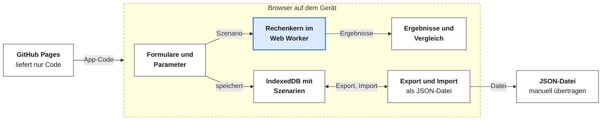

# Spezifikation: Wattwahl – E-Auto-Entscheidungshilfe

Nov 13, 2026 · @Eduard Vodicka

## Ziel und Rahmen

Wattwahl zeigt, welcher von mehreren E-Auto-Kandidaten (Kauf oder Leasing) zusammen mit dem Bestands-Verbrenner die niedrigsten Gesamtkosten verursacht und ob seine Reichweite für die Arbeitswege in jedem Monat reicht.

**Ausgangslage**

- Ein Haushalt mit einem Verbrenner (Benzin), der behalten wird. Das E-Auto kommt hinzu und ersetzt ihn nicht.
- Zwei Arbeitsstätten mit je einer Person. An manchen Tagen sind beide besetzt, dann werden beide Autos gleichzeitig gebraucht.
- Zusätzlich eine monatliche Strecke (Wochenende, Besorgungen) ohne Reichweitenprüfung.

**Ergebnis je Kandidat und Angebot (Kauf und jede Leasingstufe)**

1. Eignung: Reicht die Reichweite auf jedem Arbeitsweg in jedem Monat? Berücksichtigt werden Winter, Akkualterung und das Ladefenster 10–80 %.
2. Optimale Zuordnung der Autos zu den Arbeitswegen je Wochentag und Monat sowie die daraus folgenden Mindestkosten.
3. Vergleich aller Kandidaten mit Kosten, Reichweitenreserve und Garantie-Hinweisen.

**Nicht Teil der Anwendung**

- Routenplanung, Live-Preise, Benutzerkonten, Server.
- Reichweitenprüfung der Zusatzstrecke, von Urlaubs- und Langstrecken.
- Nicht-monetäre Kriterien (Kofferraum, Sitzplätze, Ladeleistung) und Ranking mit Gewichtung.
- Versicherung, Kfz-Steuer, Förderungen und Einmalkosten wie Wallbox-Einbau, Überführung und Zulassung (bei Kauf und Leasing).
- Finanzierung und Zinsen (es wird ein Barkauf betrachtet).
- Prüfung der Heim-Ladezeit: Es wird nur der Strompreis erfasst.

## Festlegungen aus der Anforderungsklärung

Die folgenden Entscheidungen sind verbindlich und bilden die Grundlage aller weiteren Abschnitte.

| Thema | Festlegung |
| --- | --- |
| Fahrzeugpark | Verbrenner bleibt, E-Auto kommt hinzu. Beide werden je Tagestyp und Anwesenheitszustand optimal auf die Wege verteilt. |
| Personen | Eine Person je Arbeitsstätte. Sind beide am selben Tag besetzt, sind beide Autos im Einsatz. |
| Fahrwege | Einfache Strecke je Straßenart (Stadt, Land, Autobahn). Hin- und Rückweg werden verdoppelt. |
| Zusatzstrecke | Kilometer je Straßenart und Monat, konstant über das Jahr. Nur Summe, keine Reichweitenprüfung. |
| Straßenarten E-Auto | Reichweiten nach EV-Database-Schema: Stadt, Autobahn, kombiniert, jeweils mild und kalt. Land entspricht kombiniert. |
| Autobahntempo | Prozentabschlag auf die Autobahnreichweite, einstellbar je Szenario. |
| Reichweite reicht nicht | Der Kandidat gilt als ungeeignet. Der Verbrenner springt nicht als Ersatz ein, wenn beide Autos gebraucht werden. Genaue Regel im Abschnitt Optimierung. |
| Jahreszeiten | Monatsweise Durchschnittstemperatur. Die Reichweite wird linear zwischen Kalt- und Mild-Wert interpoliert. |
| Ladefenster | 10–80 % überall (Heim und Arbeit), dazu ein einstellbarer Sicherheitspuffer in %. |
| Laden am Arbeitsplatz | Es wird immer auf 80 % geladen. Nur eine Strecke zählt gegen die Reichweite. Der Strom ist kostenlos. |
| Laden zu Hause | Nur Strompreis, Ladung bis 80 %. Die Zusatzstrecke wird zu Hause geladen. Kein öffentliches Laden. |
| Akkualterung | Linear über die Laufleistung bis 85 % SoH. Bei Gebrauchten optional ein bekannter SoH. |
| Verbrenner | Verbrauch je Straßenart in l/100 km, Benzinpreis als Spanne. Die aktuelle Laufleistung ist informativ, angezeigt wird die geplante Laufleistung am Ende der Vergleichsdauer. |
| Preise | Benzin und Heimstrom je als Minimum, Mittel und Maximum plus jährliche Preissteigerung. |
| Arbeitstage | Wochentage × 52 Wochen minus freie Tage je Arbeitsstätte. |
| Kauf | Jeder Kandidat hat immer ein Kaufangebot, Leasingangebote sind optional zum Vergleich. Wertverlust in % pro Jahr ergibt den Restwert. Die Vergleichsdauer ist einstellbar. |
| Weitere Kosten | Nur Wartung und Reifen in €/km, getrennt für E-Auto und Verbrenner. |
| Leasing | Stufen 10.000, 15.000, 20.000 und 25.000 km pro Jahr mit Rate, Laufzeit, Anzahlung, Mehr- und Minderkilometer. Überführung und Zulassung werden weder bei Kauf noch bei Leasing erfasst. |
| Garantie | Jahres-km-Budget = Garantie-km ÷ Garantiejahre (bei Gebrauchten die Restgarantie). Ziel des Optimierers, Verletzung nur Warnung. Abgelaufene Restgarantie (0 Jahre oder 0 km): kein Budget, Hinweis „ohne Garantie“. |
| Kriterien | Nur Kosten, Reichweite und Garantie. |
| Kennzahlen | Gesamtkosten über die Vergleichsdauer und Reichweitenreserve je Weg und Monat. |
| Szenarien | Benannte Szenarien speichern, duplizieren und vergleichen. |
| Dateneingabe | Manuell mit Vorlage und Duplizieren, kein Import aus externen Datenquellen. Der JSON-Import dient nur dem Abgleich eigener Daten. |
| Plattform | Wattwahl ist eine statische PWA auf GitHub Pages (öffentliches Repository). Daten bleiben lokal, Abgleich über Export/Import-Datei. |
| Sprache und Einheiten | Deutsch, Euro, Kilometer, Dezimalkomma (Annahme). |

## Begriffe und Konventionen

Alle Berechnungen nutzen die folgenden Begriffe in genau dieser Bedeutung.

| Begriff | Bedeutung |
| --- | --- |
| Straßenart | Stadt (innerorts), Land (Landstraße), Autobahn. |
| Weg | Einfache Strecke von zu Hause zu einer Arbeitsstätte, aufgeteilt in km je Straßenart. Ein Arbeitstag ist Hinweg plus Rückweg. |
| Reichweitenwerte | Sechs Realreichweiten eines E-Autos bei 100 % bis 0 % Akku nach EV-Database-Schema: Stadt, Autobahn, kombiniert, jeweils mild und kalt. |
| Bezugstemperaturen | T\_kalt und T\_mild, zu denen die Reichweitenwerte gehören. Standard −10 °C und 23 °C, einstellbar. |
| Netto-Kapazität | Nutzbare Akkukapazität in kWh. Sie wird zusätzlich zu den Reichweiten erfasst, damit der Verbrauch abgeleitet werden kann. |
| Ladefenster | Untere Grenze 10 %, obere Grenze 80 %. Nutzbarer Anteil u₀ = 70 % der Kapazität. |
| Sicherheitspuffer | Prozentabschlag auf den nutzbaren Anteil, Standard 10 %. Ergibt u = 0,70 × 0,90 = 0,63. |
| SoH | State of Health, Anteil der Ursprungskapazität. Verringert die Reichweite proportional. |
| Tagestyp | Kombination aus Wochentag und Monat. Ein Tagestyp hat bis zu drei Anwesenheitszustände: beide besetzt, nur A, nur B. |
| Plan | Die Zuordnung der beiden Autos zu den Arbeitsstätten je Tagestyp und Anwesenheitszustand: E-Auto fährt A, E-Auto fährt B oder E-Auto ruht. |
| Angebot | Das Kaufangebot (immer vorhanden) oder eine Leasingstufe (optional) eines Kandidaten. Jedes Angebot wird einzeln berechnet. |
| Vergleichsdauer | Zeitraum D in Monaten, über den alle Gesamtkosten verglichen werden. Standard 48 Monate. |
| Preisfall | Auswahl von Benzinpreis und Strompreis aus Minimum, Mittel oder Maximum. |
| Flotte | Neues E-Auto plus Bestands-Verbrenner. Gesamtkosten beziehen sich immer auf die Flotte. |

## Datenmodell

Ein Szenario bündelt alle Eingaben und ist die kleinste speicher- und vergleichbare Einheit. Alle Felder sind über die Oberfläche änderbar, Pflichtfelder sind markiert.

### Szenario

| Feld | Typ | Regel |
| --- | --- | --- |
| Name | Text | Pflicht, eindeutig |
| Bestandsfahrzeug | 1 Objekt | Pflicht |
| Arbeitsstätten | genau 2 Objekte (A und B) | Pflicht |
| Zusatzstrecke | 1 Objekt | Pflicht, darf 0 sein |
| Parameter | Objekt, siehe Parameterliste | Standardwerte vorbelegt |
| Kandidaten | 0 bis n Objekte | Berechnung ab 1 Kandidat |

### Bestandsfahrzeug (Verbrenner)

| Feld | Einheit | Regel |
| --- | --- | --- |
| Name | Text | Pflicht |
| Verbrauch Stadt, Land, Autobahn | l/100 km | je > 0 |
| Aktuelle Laufleistung | km | ≥ 0, informativ. Die App zeigt daraus die geplante Laufleistung am Ende der Vergleichsdauer. |
| Wartung und Reifen | €/km | ≥ 0 |
| Benzinpreis Minimum, Mittel, Maximum | €/l | Min ≤ Mittel ≤ Max |
| Preissteigerung Benzin | % pro Jahr | Standard 0 |

### Arbeitsstätte (A und B)

| Feld | Einheit | Regel |
| --- | --- | --- |
| Name | Text | Pflicht |
| Weg Stadt, Land, Autobahn | km, einfache Strecke | je ≥ 0, Summe > 0 |
| Besuchte Wochentage | Mo bis So, Mehrfachauswahl | mindestens ein Tag |
| Freie Tage pro Jahr | Tage | 0 bis Arbeitstage, Urlaub, Feiertage, Homeoffice |
| Kostenloses Laden vor Ort | Ja oder Nein | Strom 0 €, Laden auf 80 % |

### Zusatzstrecke

| Feld | Einheit | Regel |
| --- | --- | --- |
| Kilometer pro Monat in Stadt, Land, Autobahn | km | je ≥ 0, in jedem Monat gleich |

### E-Auto-Kandidat

| Feld | Einheit | Regel |
| --- | --- | --- |
| Name, Notiz | Text | Name Pflicht |
| Zustand | neu oder gebraucht | Pflicht |
| Kaufpreis | € | Pflicht, > 0. Jeder Kandidat hat ein Kaufangebot |
| Erstzulassung | Monat und Jahr | nur bei gebraucht |
| Laufleistung | km | neu: 0, gebraucht: ≥ 0 |
| Netto-Akkukapazität | kWh | > 0 |
| Reichweite Stadt, Autobahn, kombiniert, jeweils mild und kalt | km | sechs Felder > 0, Warnung wenn kalt > mild |
| SoH aktuell | % | optional, nur gebraucht, 50 bis 100 |
| Fahrzeuggarantie | Restjahre und Restkilometer | neu: volle Garantie, gebraucht: Restgarantie, 0 = abgelaufen |
| Akkugarantie | Restjahre und Restkilometer | wie Fahrzeuggarantie |
| Wertverlust | % pro Jahr | optional, überschreibt den Szenario-Standard |
| Wartung und Reifen | €/km | optional, überschreibt den Szenario-Standard |
| Leasingangebote | 0 bis 4 Objekte | optional zum Vergleich mit dem Kauf, je Stufe höchstens eines |

### Leasingangebot

| Feld | Einheit | Regel |
| --- | --- | --- |
| Stufe | km pro Jahr | Vorbelegt 10.000, 15.000, 20.000, 25.000, änderbar |
| Monatliche Rate | € | > 0 |
| Geplante Laufzeit | Monate | > 0 |
| Anzahlung | € | ≥ 0, einmalig |
| Mehrkilometerpreis | €/km | ≥ 0 |
| Minderkilometer-Erstattung | €/km | ≥ 0 |

### Validierung

- Jedes Feld prüft Typ, Einheit und Bereich beim Verlassen. Pflichtfelder mit Fehler blockieren die Berechnung des betroffenen Kandidaten, nicht die der anderen.
- Unplausible Werte (Kalt-Reichweite größer als Mild-Reichweite, Netto-Kapazität über 200 kWh, Weg über 300 km) lösen eine Warnung aus und blockieren nicht.
- Dezimalkomma und Punkt werden bei der Eingabe akzeptiert. Ein Punkt, auf den genau drei Ziffern folgen, gilt als Tausenderpunkt („40.000“ ergibt 40000, „1.234,5“ ergibt 1234,5), sonst ist ein einzelner Punkt oder ein einzelnes Komma das Dezimaltrennzeichen („12.5“ und „12,5“ ergeben 12,5). Mehrdeutige oder unlesbare Eingaben werden mit Meldung abgewiesen.

## Berechnungslogik

Alle Größen werden pro Kandidat, pro Monat m und pro Weg w (Arbeitsstätte A oder B) berechnet. Die Straßenarten sind i ∈ {Stadt, Land, Autobahn}.

### 1. Reichweite bei Monatstemperatur

Die Mild- und Kaltwerte werden linear nach der Temperatur gemischt. Für die Kostenrechnung gilt die Monatstemperatur T\_m, für die Eignungsprüfung zusätzlich die Kältereserve ΔT, damit kältere Tage innerhalb des Monats abgedeckt sind.

$$
w_m = \min\left(1,\ \max\left(0,\ \frac{T_m - T_{kalt}}{T_{mild} - T_{kalt}}\right)\right)
$$

$$
w_m^{*} = \min\left(1,\ \max\left(0,\ \frac{T_m - \Delta T - T_{kalt}}{T_{mild} - T_{kalt}}\right)\right)
$$

$$
R_j(m) = R_j^{kalt} + w_m \left(R_j^{mild} - R_j^{kalt}\right), \quad j \in \{\text{Stadt}, \text{Autobahn}, \text{kombiniert}\}
$$

Zuordnung auf die Straßenarten: Stadt = Stadt, Land = kombiniert, Autobahn = Autobahn × (1 − a) mit dem Autobahn-Abschlag a. Die Prüfwerte R\*\_i(m) nutzen w\*\_m statt w\_m.

### 2. Akkualterung (SoH)

Die Alterung ist linear über die Laufleistung und endet bei SoH\_min. Bei Gebrauchten mit bekanntem SoH\_0 startet sie bei diesem Wert und der Kilometerstand k\_0 ist der Startpunkt.

$$
s = \frac{1 - SoH_{min}}{k_{SoH}}, \qquad SoH(k) = \max\left(\min(SoH_{min}, SoH_0),\ SoH_0 - s\,(k - k_0)\right)
$$

Ohne bekannten SoH gilt SoH\_0 = 1 bei k\_0 = 0, also SoH(k) = max(SoH\_min, 1 − s · k). Die Kurve beginnt beim aktuellen Kilometerstand des Kandidaten (bei Neuwagen 0), ein bekannter SoH\_0 gilt an diesem Stand. Die Eignungsprüfung nutzt den SoH am Ende der Vergleichsdauer, k\_end = Kilometerstand + K\_EV · D/12 (umschaltbar auf Start). K\_EV sind die jährlichen E-Auto-Kilometer.

### 3. Eignung eines Wegs

Der nutzbare Anteil ist u = (80 % − 10 %) · (1 − Puffer). Der Bedarf eines Wegs in Kapazitätsanteilen ist die Summe der Teilstrecken d\_{w,i} geteilt durch die Prüfreichweiten.

$$
\varphi_{w,m} = \sum_i \frac{d_{w,i}}{R^{*}_i(m)\cdot SoH}, \qquad n_w = 2 - z_w
$$

z\_w ist 1, wenn am Arbeitsplatz geladen werden kann, sonst 0. Mit Laden vor Ort zählt nur eine Strecke gegen die Reichweite, ohne Laden Hin- und Rückweg.

$$
\text{geeignet} \iff n_w \cdot \varphi_{w,m} \le u
$$

$$
\text{Reserve}_{km} = d_w \left(\frac{u}{\varphi_{w,m}} - n_w\right), \qquad \text{Reserve}_{\%} = \frac{u}{n_w \, \varphi_{w,m}} - 1
$$

d\_w ist die einfache Weglänge in km. Ampel: grün ab 15 % Reserve, gelb von 0 bis 15 %, rot darunter (Schwelle einstellbar).

### 4. Verbrauch und Energie

Der Verbrauch wird aus Reichweite und Netto-Kapazität C abgeleitet. Er hängt nicht vom SoH ab, weil mit dem SoH Kapazität und Reichweite im gleichen Maße sinken.

$$
c_i(m) = \frac{C}{R_i(m)}\ \text{[kWh/km]}, \qquad E_{w,m} = \sum_i d_{w,i}\, c_i(m), \qquad E^{Netz}_{w,m} = \frac{E_{w,m}}{\eta}
$$

Pro Arbeitstag werden (2 − z\_w) · E^Netz zum Heimstrompreis bezahlt. Die Energie am Arbeitsplatz kostet 0 €. Der Verbrenner braucht pro Arbeitstag 2 · Σ d\_{w,i} · v\_i / 100 Liter (v\_i = Verbrauch in l/100 km). Wartung fällt mit 2 · d\_w km pro Tag und Auto an.

### 5. Arbeitstage

Für jede Arbeitsstätte gilt der Anwesenheitsfaktor f\_w = (52 · Wochentage\_w − freie Tage\_w) / (52 · Wochentage\_w). Je Wochentag und Monat treten im Mittel c = 52/12 Tage auf. Die erwarteten Tage je Zustand sind:

- beide besetzt (nur wenn der Wochentag in beiden Listen steht): c · f\_A · f\_B
- nur A besetzt: c · f\_A · (1 − f\_B) bei Wochentagen beider Stätten, sonst c · f\_A
- nur B besetzt: entsprechend

### 6. Zusatzstrecke

Die monatlichen Kilometer k\_i werden mit dem Anteil x\_m (0 bis 100 %) dem E-Auto zugeordnet, der Rest dem Verbrenner. Strom für diese Kilometer wird zu Hause zum Heimpreis geladen.

### 7. Preise über die Vergleichsdauer

Die Vergleichsdauer D wird in Jahre y = 1 bis ⌈D/12⌉ zerlegt, q\_y ist der Anteil des Jahres y an D in Jahren, q\_y = min(12, D − 12(y−1)) / 12, sodass Σ q\_y = D/12 gilt. Die Mengen gelten in jedem Jahr gleich.

$$
F_b = \sum_y q_y\,(1+g_b)^{y-1}, \qquad F_s = \sum_y q_y\,(1+g_s)^{y-1}, \qquad F_m = \frac{D}{12}
$$

g\_b und g\_s sind die jährlichen Preissteigerungen für Benzin und Strom. Kosten = Jahresmenge · Preis · F. Wartungskosten steigen nicht.

### 8. Gesamtkosten der Flotte über die Vergleichsdauer

- **Kauf:** Anschaffung = P − P · (1 − w)^(D/12) mit Kaufpreis P und Wertverlust w pro Jahr.
- **Leasing (Stufe t):** D · (Rate + Anzahlung / L) + D/12 · (Mehr − Minder), wobei Mehr = max(0, K\_EV − K\_t) · Mehrkilometerpreis und Minder = max(0, K\_t − K\_EV) · Erstattungssatz. L ist die Leasingdauer. Ist L ≠ D, wird mit gleichen Konditionen fortgesetzt oder gekürzt (Vereinfachung).
- **Energie:** E-Auto Strom zu Hause · p\_s · F\_s plus Benzin des Verbrenners · p\_b · F\_b.
- **Wartung und Reifen:** F\_m · (m\_EV · K\_EV + m\_ICE · K\_ICE), K\_ICE = Gesamtkilometer − K\_EV.

Der Verbrenner geht nur mit seinen kilometerabhängigen Kosten ein. Feste Kosten des Bestands (Wertverlust, Steuer, Versicherung) fallen in allen Varianten gleich an und werden nicht erfasst. Seine geplante Laufleistung am Ende der Vergleichsdauer ist k\_ICE,0 + K\_ICE · D/12 (k\_ICE,0 = aktuelle Laufleistung) und wird nur angezeigt.

## Optimierung

Für jedes Angebot wählt der Optimierer den Plan je Tagestyp und Anwesenheitszustand sowie den E-Auto-Anteil der Zusatzstrecke so, dass die Flottenkosten minimal sind. Die Eignung ist eine harte Bedingung, das Garantie-Budget ein Ziel (siehe unten). Jede Leasingstufe ist ein eigenes Angebot.

### Entscheidungen und Zulässigkeit

Je Tagestyp (Wochentag d, Monat m) wählt der Optimierer für jeden Anwesenheitszustand eine eigene Planoption. Welche Zustände auftreten, folgt aus den besuchten Arbeitsstätten V\_d und den freien Tagen (Abschnitt 5 der Berechnungslogik):

| Anwesenheitszustand | Planoptionen |
| --- | --- |
| nur A besetzt | E-Auto fährt A, oder E-Auto ruht (Verbrenner fährt A) |
| nur B besetzt | E-Auto fährt B, oder E-Auto ruht (Verbrenner fährt B) |
| A und B besetzt | E-Auto fährt A (Verbrenner fährt B), oder E-Auto fährt B (Verbrenner fährt A) |

Das Ruhen ist bei A und B nicht erlaubt, weil der Verbrenner nicht zwei Wege gleichzeitig fahren kann. Weil jeder Zustand eine eigene Option hat, fährt das E-Auto an Tagen mit nur einer besetzten Stätte diesen Weg, sobald er zulässig und günstiger ist, auch wenn es an Tagen mit beiden Stätten die andere Stätte fährt.

Zusätzlich wählt der Optimierer je Monat den E-Auto-Anteil x\_m der Zusatzstrecke in 10-%-Schritten. Die Zusatzstrecke hat keine Reichweitenprüfung und ist immer zulässig.

Eine Option "E-Auto fährt w" ist in jedem Zustand des Tagestyps (d, m) nur zulässig, wenn die Eignung des Wegs w im Monat m erfüllt ist.

### Ungeeignet

Ein Angebot gilt als ungeeignet, wenn es einen Tagestyp mit dem Zustand „A und B besetzt“ gibt, in dem keine der beiden Optionen zulässig ist. Es wird dann nicht weiter bewertet, aber in der Ergebnisliste mit dem Grund angezeigt (Weg, Monat, fehlende Reserve in km).

Optional kann der Streng-Modus eingeschaltet werden (Standard aus): Dann ist ein Angebot auch ungeeignet, wenn das E-Auto irgendeinen besuchten Weg in irgendeinem Monat nicht fahren kann, selbst wenn der Verbrenner ihn übernehmen könnte.

### Algorithmus

Die SoH am Ende der Vergleichsdauer hängt von den E-Auto-Kilometern K\_EV ab, und diese hängen vom Plan ab. Die Kopplung wird exakt auf einem Kilometerraster aufgelöst (Standard 250 km pro Jahr).

1. Für jede Planoption wird der Schwellen-SoH bestimmt, ab dem sie zulässig ist. Die Menge der zulässigen Optionen ändert sich nur an diesen Schwellen.
2. Für jeden Rasterwert K wird SoH(K) berechnet und daraus die zulässige Optionsmenge bestimmt. Rasterwerte mit gleicher Optionsmenge teilen sich eine Rechnung.
3. Je Optionsmenge löst eine dynamische Programmierung (Rucksack über alle Tagestypen mit ihren Anwesenheitszuständen und die zwölf Zusatzstrecken-Monate) die minimalen variablen Kosten für jede E-Auto-Jahresstrecke K. Variable Kosten sind Energie beider Autos und Wartung.
4. Zielkosten(K) = variable Kosten(K) + Anschaffung. Bei Leasing kommen Mehr- und Minderkilometer als Funktion von K dazu, und jede Stufe wird einzeln bewertet.
5. Gewählt wird das K mit den kleinsten Zielkosten unter Beachtung des Garantie-Budgets (nächster Abschnitt). Bei Kostengleichheit (± 0,01 €) gewinnt die größere kleinste Reichweitenreserve über alle Wege und Monate, danach die kleinere E-Auto-Strecke.
6. Das Ergebnis enthält den Plan je Tagestyp und Zustand, K\_EV, K\_ICE, die geplante Laufleistung des Verbrenners am Ende, SoH am Ende, die Kostenanteile, die Reserve je Weg und Monat sowie Warnungen.

Die Optimierung läuft je Preisfall: Mittel, "E-Auto günstig" (Benzin Maximum, Strom Minimum) und "E-Auto ungünstig" (Benzin Minimum, Strom Maximum). Ein Regler-Szenario aus der Oberfläche erzeugt einen weiteren Lauf.

### Garantie-Budget

Das Jahresbudget ist B = min(Fahrzeugkilometer ÷ Fahrzeugjahre, Akkukilometer ÷ Akkujahre) auf Basis der Restgarantie. Es soll verhindern, dass die Kilometergrenze lange vor dem Zeitende erreicht wird. Eine abgelaufene Restgarantie (0 Jahre oder 0 km) fließt nicht in B ein. Sind beide abgelaufen, ist das Budget aus und das Angebot zeigt „ohne Garantie“.

- Liegt die kostenoptimale Strecke bei K\_EV ≤ B, wird sie gewählt.
- Liegt sie darüber, wählt der Optimierer die günstigste Strecke mit K\_EV ≤ B und weist die Mehrkosten als "Mehrkosten durch Garantie-Budget" aus.
- Erzwingen die Plan-Bedingungen ein K\_EV > B (zum Beispiel weil A und B am selben Tag besetzt sind und nur das E-Auto einen Weg schafft), wird die kleinste zulässige Strecke gewählt und eine Warnung mit Jahren bis zur Kilometergrenze angezeigt. Das Angebot bleibt im Vergleich.
- Bei Leasing ist die Stufe die Kilometergrenze. Das Garantie-Budget ist dort nicht aktiv.
- Das Verhalten ist umschaltbar (Standard: Ziel aktiv).

## Auswertung und Visualisierung

Die Ergebnisansicht zeigt für jedes Angebot die Gesamtkosten über die Vergleichsdauer und die Reichweitenreserve je Weg und Monat, nebeneinander für alle Kandidaten. Es gibt keine Gewichtung und kein Punkteranking, nur die Sortierung nach Kosten.

| Ansicht | Inhalt | Darstellung |
| --- | --- | --- |
| Kostenvergleich | Gesamtkosten der Flotte über D, aufgeteilt in Anschaffung oder Leasing, Strom, Benzin, Wartung und Reifen | Gestapelte Balken je Angebot, aufsteigend sortiert. Ein Strich zeigt die Spanne von "E-Auto günstig" bis "E-Auto ungünstig". Daneben dieselben Werte als Tabelle. |
| Reichweitenreserve | Reserve in km und % je Weg (A, B) und Monat, SoH am Ende der Vergleichsdauer | Heatmap mit Ampelfarbe und Zahl in der Zelle, ein Kandidat per Auswahl. Auf dem Handy horizontal scrollbar. |
| Zuordnungsplan | Welches Auto fährt je Wochentag, Monat und Anwesenheitszustand zu welcher Arbeitsstätte | Raster Wochentag × Monat, je Zelle eine Zeile für beide, nur A und nur B, mit "E→A", "E→B" oder "E ruht". Winterwechsel sind hervorgehoben. |
| Garantie | Jahresbudget in km, geplante E-Auto-Kilometer, Jahre bis zur Kilometergrenze gegenüber der Restgarantie | Kachel mit Ampel und Mehrkosten durch das Budget |
| Rechenweg | Zwischenwerte je Angebot: Reichweiten je Monat, Verbrauch in kWh/100 km, Energie pro Tag, Jahresmengen, Preisfaktoren | Aufklappbar, jede Zahl mit Formelverweis |
| Szenariovergleich | Gesamtkosten je Kandidat in zwei oder mehr Szenarien | Nebeneinanderliegende Balken je Kandidat |

### Ergebnistabelle

Jede Zeile ist ein Angebot (Kauf oder Leasingstufe) mit diesen Spalten: Kandidat, Angebot, Eignung, Gesamtkosten (Mittel) mit Spanne, kleinste Reichweitenreserve in km und % (mit Weg und Monat) über die Wege, die das E-Auto im Plan fährt, also nie negativ (fährt es nie, steht dort kein Wert), E-Auto-Kilometer pro Jahr, geplante Laufleistung des Verbrenners am Ende der Vergleichsdauer, Garantie-Status (auch „ohne Garantie“). Ungeeignete Angebote stehen am Ende, ausgegraut, mit dem Grund. Klick auf eine Zeile öffnet die Detailansichten.

### Preis-Simulation

- Regler für Benzinpreis, Heimstrompreis und beide Preissteigerungen. Die Berechnung läuft sofort neu.
- "Als Szenario speichern" legt die geänderten Preise als neues Szenario ab, damit sie im Szenariovergleich stehen.

### Darstellungsregeln

- Alle Farben und Ampelschwellen sind einstellbar, die Ampel wird nie allein über Farbe kodiert (zusätzlich Symbol oder Zahl).
- Kosten in vollen Euro, Reserve in ganzen km, Verbrauch mit einer Nachkommastelle.
- Jede Ansicht nennt Szenario, Preisfall, Vergleichsdauer und Stand der Berechnung.

## Bedienung

Die Oberfläche ist eine einzige Anwendung mit fünf Bereichen, die am Desktop als Seitenleiste und auf dem Handy als untere Navigationsleiste erscheinen. Jede Eingabe wird sofort gespeichert und die Ergebnisse rechnen live neu.

| Bereich | Inhalt |
| --- | --- |
| Fahrprofil | Bestandsfahrzeug, Arbeitsstätte A, Arbeitsstätte B, Zusatzstrecke |
| Kandidaten | Liste mit Karten, Formular je Kandidat, Leasingangebote |
| Parameter | Alle Rechenparameter mit Standardwert und Zurücksetzen je Feld, Preise und Preissteigerung |
| Ergebnis | Vergleich, Reichweitenreserve, Zuordnungsplan, Garantie, Rechenweg, Preis-Regler |
| Szenarien und Daten | Szenarioliste, Szenariovergleich, Export, Import, Hinweis zum letzten Export |

### Eingabe

- Das Kandidatenformular hat Gruppen nach der Logik der EV Database: Allgemein, Akku, Reichweite Stadt, Autobahn und kombiniert jeweils mild und kalt, Garantie, Preis. Jedes Feld nennt seine Einheit.
- Ein neuer Kandidat startet aus einer leeren Vorlage. "Duplizieren" kopiert einen vorhandenen Kandidaten, zum Beispiel für eine andere Ausstattungsvariante.
- Auf dem Handy führt das Formular in Schritten (Allgemein, Akku und Reichweite, Garantie, Leasing). Auf dem Desktop stehen alle Gruppen untereinander.
- Ungeeignete oder unvollständige Kandidaten bleiben in der Liste und zeigen den Grund auf der Karte.
- Alle Parameter sind in der Oberfläche änderbar. Geänderte Standardwerte sind markiert.

### Szenarien

- Anlegen, Umbenennen, Duplizieren und Löschen (mit Bestätigung). Ein neues Szenario kann leer starten oder eine Kopie sein.
- Der Szenariovergleich zeigt Gesamtkosten je Kandidat für zwei oder mehr ausgewählte Szenarien.

### Gestaltung

- Responsives Layout: ab etwa 900 px Breite Seitenleiste und zwei Spalten, darunter eine Spalte mit unterer Navigation.
- Tablet hochkant (600 bis 899 px): Layout wie am Handy, der Inhalt ist höchstens 720 px breit und mittig. Formulare zeigen zwei Felder nebeneinander, Ergebniskarten stehen in zwei Spalten.
- Tablet quer (900 bis 1199 px): Layout wie am Desktop mit schmalerer Seitenleiste. Feldgruppen mit drei Feldern stehen untereinander, damit Zahl und Einheit Platz haben. Die Ergebnistabelle scrollt seitlich, die Spalte Kandidat bleibt stehen.
- Bedienelemente mindestens 44 px hoch auf dem Handy, Zahlenfelder mit passender Tastatur und Einheit am Feldende.
- Hell und dunkel nach Systemeinstellung. Kontraste nach WCAG AA, Ampelwerte mit Symbol.
- Sprache Deutsch, Dezimalkomma, Tausenderpunkt, Euro. Texte liegen in einer Sprachdatei, damit später weitere Sprachen möglich sind.

## Technik und Hosting

Wattwahl ist eine rein clientseitige Progressive Web App ohne Server, die als statische Seite über GitHub Pages ausgeliefert wird. Alle Daten bleiben im Browser des jeweiligen Geräts.

**Datenfluss · 7 Elemente, alles lokal**

*Alle Daten und Berechnungen bleiben im Browser des Geräts.*

Die Formulare speichern in IndexedDB und speisen den Rechenkern im Web Worker, der die Ergebnisansichten füllt. Nur die Export-Datei verlässt die App, und GitHub Pages liefert ausschließlich den Code.

### Umsetzung

- **Empfohlener Stack:** TypeScript, Vite und ein leichtgewichtiges UI-Framework (Preact oder React). Diagramme als SVG. Keine Laufzeit-Abhängigkeit von externen Diensten.
- **Rechenkern:** Reine, framework-unabhängige Funktionen ohne Zugriff auf die Oberfläche, ausgeführt in einem Web Worker, damit die Oberfläche bei der Optimierung nicht blockiert.
- **Speicherung:** IndexedDB, ein Eintrag je Szenario, automatisches Speichern nach jeder Änderung. Beim ersten Start wird dauerhafter Speicher angefordert. Jeder Eintrag trägt eine Schemaversion, ältere Versionen werden beim Laden migriert.
- **Offline:** Ein Service Worker legt die App im Cache ab. Bei neuer Version erscheint ein Hinweis zum Aktualisieren.

### Daten zwischen Geräten

- Export als JSON-Datei mit Schemaversion und Datum im Dateinamen, wahlweise alle Szenarien oder eines.
- Import prüft Schema und Version. Der Nutzer wählt "ersetzen" oder "als neue Szenarien hinzufügen". Bei Fehlern wird die betroffene Stelle genannt und nichts überschrieben.
- Eine Erinnerung weist nach einer einstellbaren Zahl Tage ohne Export darauf hin (Standard 14 Tage). Die Zahl ist eine Geräteeinstellung, gilt für alle Szenarien und wird nicht exportiert.

### Hosting auf GitHub Pages

- Öffentliches Repository, da GitHub Pages im kostenlosen Plan nur für öffentliche Repositories verfügbar ist. Es enthält ausschließlich Code, keine Nutzerdaten.
- Build und Veröffentlichung über GitHub Actions bei jedem Push auf den Hauptzweig.
- Die Adresse muss stabil bleiben, weil der Browser-Speicher an sie gebunden ist. Vor einer Adressänderung wird exportiert.
- Keine Cookies, keine Analyse, keine Netzwerkaufrufe außer dem Laden der App.

### Bekannte Plattformgrenzen

- Safari auf iOS kann Webdaten von Seiten, die nicht auf dem Home-Bildschirm installiert sind, nach etwa sieben Tagen ohne Nutzung löschen. Die App weist beim ersten Start auf die Installation hin und erinnert an den Export.
- Browser-Speicher kann vom Nutzer oder System geräumt werden. Der Export ist die einzige Sicherung.
- Unterstützt werden aktuelle Versionen von Chrome, Edge, Firefox und Safari auf Desktop und Handy.

## Nicht-funktionale Anforderungen

Die App muss schnell, nachvollziehbar und robust gegen falsche Eingaben sein. Die folgenden Werte sind Abnahmekriterien.

| Bereich | Anforderung |
| --- | --- |
| Performance | Vollständige Neuberechnung mit 10 Kandidaten (je Kauf plus 4 Leasingstufen) und 3 Preisfällen in höchstens 5 s auf einem aktuellen Mittelklasse-Handy und 2 s am Desktop. Die Oberfläche bleibt dabei bedienbar. |
| Determinismus | Gleiche Eingaben liefern bitgleiche Ergebnisse. Der Rechenkern nutzt weder Zufall noch Uhrzeit. |
| Nachvollziehbarkeit | Jede Ergebniszahl lässt sich im Rechenweg auf Eingaben und Formel zurückführen. |
| Datensicherheit | Kein Datenabfluss. Importierte Dateien werden nur als Daten gelesen und nie als Code ausgeführt. |
| Robustheit | Ungültige Eingaben, unvollständige Kandidaten und fehlerhafte Importdateien führen nie zum Absturz oder zum stillen Verlust von Daten. |
| Persistenz | Nach Neuladen und nach Schließen des Browsers ist der Stand wiederhergestellt. |
| Barrierefreiheit | Bedienbar per Tastatur, Beschriftungen für Screenreader, Kontrast nach WCAG AA. |
| Wartbarkeit | Rechenkern mit Unit-Tests gegen die Beispiele im Abschnitt Testfälle. Formeln stehen in genau einem Modul. |
| Transparenz der Annahmen | Jeder Standardwert, der ein Platzhalter ist, ist in der Oberfläche als Annahme gekennzeichnet. |

## Parameterliste mit Standardwerten

Jeder Parameter ist in der Oberfläche änderbar. "Platzhalter" heißt: Der Wert ist eine Annahme von mir und muss geprüft werden. "Pflichteingabe" heißt: Es gibt bewusst keinen Standardwert, weil er aktuelle Marktpreise oder persönliche Daten betrifft.

| Parameter | Standard | Einheit | Hinweis |
| --- | --- | --- | --- |
| Vergleichsdauer D | 48 | Monate | höchstens 1.200 (100 Jahre) |
| Untere Ladegrenze | 10 | % |  |
| Obere Ladegrenze | 80 | % | gilt für Heim und Arbeit |
| Sicherheitspuffer | 10 | % | Platzhalter |
| SoH-Untergrenze | 85 | % |  |
| Kilometer bis zur SoH-Untergrenze | 200.000 | km | Platzhalter |
| SoH-Bezug der Eignungsprüfung | Ende der Vergleichsdauer | Auswahl | Alternative: Start |
| Ladewirkungsgrad | 90 | % | Platzhalter, Verluste zwischen Netz und Akku |
| Bezugstemperatur kalt | −10 | °C | Schema der EV Database, Platzhalter |
| Bezugstemperatur mild | 23 | °C | Schema der EV Database, Platzhalter |
| Monatstemperaturen | Jan 1, Feb 2, Mär 5, Apr 9, Mai 14, Jun 17, Jul 19, Aug 19, Sep 15, Okt 10, Nov 5, Dez 2 | °C | Platzhalter, an den Wohnort anpassen |
| Kältereserve ΔT | 5 | K | Platzhalter, deckt kältere Tage im Monat ab |
| Autobahn-Abschlag | 12 | % | Platzhalter, für schnelleres Fahren als im Referenztest |
| Ampel grün ab Reserve | 15 | % |  |
| Wertverlust | 15 | % pro Jahr | Platzhalter, je Kandidat überschreibbar |
| Wartung und Reifen E-Auto | Pflichteingabe | €/km | je Kandidat überschreibbar |
| Wartung und Reifen Verbrenner | Pflichteingabe | €/km |  |
| Benzinpreis Minimum, Mittel, Maximum | Pflichteingabe | €/l |  |
| Heimstrompreis Minimum, Mittel, Maximum | Pflichteingabe | €/kWh |  |
| Preissteigerung Benzin und Strom | 0 | % pro Jahr | getrennt einstellbar |
| Arbeitswochen pro Jahr | 52 | Wochen |  |
| Freie Tage je Arbeitsstätte | 30 | Tage pro Jahr | Platzhalter |
| Zuordnung der Zusatzstrecke | frei optimiert | Auswahl | Alternative: fester E-Auto-Anteil in % |
| Anteilsschritt Zusatzstrecke | 10 | % |  |
| Streng-Modus | aus | Schalter | siehe Optimierung |
| Garantie-Budget als Ziel | an | Schalter |  |
| Kilometerraster der Optimierung | 250 | km pro Jahr |  |
| Export-Erinnerung | 14 | Tage |  Geräteeinstellung, gilt für alle Szenarien, nicht im Export |

## Testfälle und Abnahmekriterien

Die Rechenbeispiele sind von Hand nachgerechnet und dienen als Unit-Tests des Rechenkerns. Preise in den Beispielen sind frei gewählt und keine Marktdaten.

**Gemeinsame Beispieldaten:** Kandidat mit 60 kWh Netto-Kapazität, neu. Reichweite mild: Stadt 420, Autobahn 300, kombiniert 360 km. Reichweite kalt: Stadt 300, Autobahn 220, kombiniert 260 km. Puffer 10 %, Autobahn-Abschlag 0 %, ΔT 0, η = 90 %. Weg A: 10 km Stadt, 15 km Land, 35 km Autobahn (einfach 60 km).

| Nr | Prüfung | Eingabe | Erwartet |
| --- | --- | --- | --- |
| 1 | Eignung Winter ohne Laden vor Ort | Januar, −10 °C, n = 2 | φ = 0,2501, n·φ = 0,5002 ≤ u = 0,63, geeignet. Reserve 31,1 km (25,9 %). |
| 2 | Eignung mit Laden vor Ort | wie 1, n = 1 | Reserve 91,1 km (151,9 %). |
| 3 | Temperaturmischung | T = 6,5 °C, ΔT = 0 | w = 0,5. Stadt 360, Autobahn 260, kombiniert 310 km. |
| 4 | Energie und Kosten pro Tag | wie 1, Strom 0,30 €/kWh | Verbrauch Stadt 0,200, Land 0,231, Autobahn 0,273 kWh/km. 15,01 kWh am Akku, 16,67 kWh am Netz. Tageskosten ohne Laden vor Ort 10,00 €, mit Laden vor Ort 5,00 €. |
| 5 | Verbrenner pro Tag | 8,0 / 6,0 / 7,0 l/100 km, Benzin 1,90 €/l | 4,15 l je Weg, 8,3 l pro Tag, 15,77 €. |
| 6 | SoH | 200.000 km bis 85 % | Gebraucht mit 80.000 km: 94 %. Bei 120.000 km: 91 %. Bei 250.000 km: 85 % (Untergrenze). Mit bekanntem SoH 92 % bei 80.000 km: 89 % bei 120.000 km. |
| 7 | Restwert Kauf | 40.000 €, 15 % pro Jahr, D = 48 | Restwert 20.880,25 €, Anschaffung 19.119,75 €. |
| 8 | Leasing | Rate 399 €, Anzahlung 2.000 €, Laufzeit 36, D = 36, Stufe 15.000 km, K\_EV = 18.000 km, Mehrpreis 0,08 €/km | Rate und Anzahlung 16.364 €, Mehrkilometer 3.000 km × 3 Jahre × 0,08 = 720 €, zusammen 17.084 €. |
| 9 | Arbeitstage | A: Mo bis Fr, 30 freie Tage. B: Di und Do, 10 freie Tage | f\_A = 0,8846, f\_B = 0,9038. Dienstag je Monat: beide 3,46 Tage, nur A 0,37, nur B 0,45 (Rest 0,05 beide frei). |
| 10 | Garantie-Budget | Fahrzeug 3 J / 100.000 km, Akku 8 J / 160.000 km | B = min(33.333; 20.000) = 20.000 km pro Jahr. Liegt das Kostenoptimum bei 24.000 km, wird die günstigste Strecke bis 20.000 km gewählt und die Mehrkosten werden ausgewiesen. |
| 11 | Ungeeignet | Montag beide Stätten besetzt, Reserve im Januar für A und B negativ | Angebot ungeeignet, Grund nennt Montag, Januar, beide Reserven in km. |
| 12 | Ruhen statt ungeeignet | Montag nur A besetzt, A im Januar nicht fahrbar | Plan "E ruht" im Januar, Angebot nicht ungeeignet (im Streng-Modus ungeeignet). |
| 13 | Optimierer gegen Brute Force | kleiner Fall mit 2 Wochentagen und 2 Monaten | Das Ergebnis der dynamischen Programmierung stimmt mit der vollständigen Suche überein. |
| 14 | Export und Import | Export, Browser-Speicher leeren, Import | Alle Szenarien sind unverändert wiederhergestellt. |
| 15 | Eingabeprüfung | "12,5" und "12.5", negative Zahl, leeres Pflichtfeld | Beide Schreibweisen ergeben 12,5. Negative Zahl und leeres Pflichtfeld werden mit Meldung abgewiesen. |
| 16 | Plan je Zustand | Daten wie 4 und 5, Wartung 0. Montag A und B besucht, Plan bei beiden besetzt „E-Auto fährt B“, A an 0,37 Montagen je Monat allein besetzt (wie 9) | Plan für „nur A“ ist „E→A“, weil das E-Auto 10,00 € statt 15,77 € je Tag kostet. Der Verbrenner ruht an diesen Tagen. |
| 17 | Laufleistung Verbrenner | aktuell 120.000 km, K\_ICE = 8.000 km pro Jahr, D = 48 | Geplante Laufleistung am Ende 152.000 km. Die Gesamtkosten ändern sich nicht. |
| 18 | Abgelaufene Garantie | Gebraucht, Fahrzeuggarantie 0 J / 0 km, Akku 3 J / 60.000 km. Zweiter Fall: beide 0 | B = 20.000 km pro Jahr aus der Akkugarantie. Beide abgelaufen: kein Budget, Status „ohne Garantie“, kein Fehler durch Division durch 0. |

### Abnahmekriterien

- Alle 18 Testfälle bestehen automatisiert.
- Die App läuft nach der Installation auf dem Home-Bildschirm offline und behält ihre Daten nach Neustart des Geräts.
- Desktop (1280 px), Tablet (820 px hochkant und 1024 px quer) und Handy (390 px Breite) zeigen alle Bereiche ohne abgeschnittene Eingabefelder.
- Die Leistungswerte aus dem Abschnitt Nicht-funktionale Anforderungen sind gemessen und erreicht.
- Ein Szenario mit zwei Kandidaten ist von der ersten Eingabe bis zum Vergleich ohne Hilfe bedienbar.

## Risiken, Grenzen und Entscheidungen

Alle offenen Punkte sind im Review vom 13.11.2026 entschieden und in die Abschnitte oben eingearbeitet.

| Punkt | Entscheidung | Wirkung |
| --- | --- | --- |
| Zuordnungsplan | Je Tagestyp und Anwesenheitszustand (beide, nur A, nur B) | An Tagen mit nur einer Stätte fährt das E-Auto, wenn es zulässig und günstiger ist |
| Wann ist ein Angebot ungeeignet? | Nur bei einem Tag mit beiden Stätten, den kein Plan löst. Streng-Modus optional, Standard aus | Der Verbrenner darf einzelne Wege übernehmen, ein schwaches E-Auto kann „geeignet“ bleiben |
| Wer fährt die Zusatzstrecke? | Frei auf beide Autos verteilt (Optimierer), fester Anteil als Option | Mehr Spielraum für das E-Auto, höhere E-Auto-Kilometer |
| Laufleistung des Verbrenners | Informativ, Anzeige der geplanten Laufleistung am Ende der Vergleichsdauer | Keine Wirkung auf die Kosten |
| Referenzzeile „Nur Verbrenner“ | Gestrichen | Ein einzelner Verbrenner kann Tage mit beiden Stätten nicht abdecken |
| Kauf und Leasing | Jeder Kandidat hat ein Kaufangebot, Leasing ist optional zum Vergleich | Kaufpreis bleibt Pflichtfeld |
| Überführung und Zulassung | Weder bei Kauf noch bei Leasing erfasst | Kauf und Leasing werden gleich behandelt |
| Leasing für Gebrauchtwagen | Erlaubt | Garantie-Budget ist bei Leasing nicht aktiv |
| Abgelaufene Garantie | Fließt nicht ins Budget ein, Hinweis „ohne Garantie“ | Kein Rechenfehler bei Restgarantie 0 |
| Ladedauer zu Hause | Nicht geprüft, als Modellgrenze dokumentiert | Siehe Grenzen des Modells |

### Grenzen des Modells

- **Datenqualität:** Reichweiten der EV Database sind Schätzwerte. Das Ergebnis ist nur so genau wie diese Eingaben. Darum zeigt die Ergebnisansicht Spannen statt einer exakten Zahl.
- **Temperatur:** Monatsmittel und lineare Mischung zwischen zwei Stützpunkten sind grob. Die Kältereserve ΔT mildert das, ersetzt aber keine Messung.
- **Autobahntempo:** Der Referenztest der EV Database nutzt ein festes Tempo. Der Abschlag ist eine Schätzung.
- **Heim-Ladezeit:** Die Eignung setzt voraus, dass das E-Auto jede Nacht wieder 80 % erreicht. Bei schwacher Heimladeleistung kann der Plan zu optimistisch sein.
- **Konstante Jahre:** Mengen, Plan und Preissteigerung gelten für jedes Jahr gleich. Änderungen im Fahrprofil während der Haltedauer werden nicht abgebildet.
- **Kosten nicht vollständig:** Versicherung, Kfz-Steuer, Förderung, THG-Quote, Wallbox, Überführung und Zulassung sind nicht enthalten. Die Gesamtkosten taugen für den Vergleich der Kandidaten, nicht als absolute Betriebskosten.
- **Leasing-Fortschreibung:** Weicht die Leasingdauer von der Vergleichsdauer ab, wird mit gleichen Konditionen hochgerechnet oder gekürzt.
- **Browser-Speicher:** Daten können verloren gehen, vor allem auf dem iPhone ohne installierte App. Der Export ist die Sicherung.
- **Keine Beratung:** Die App liefert Berechnungen, keine Finanz- oder Rechtsberatung.